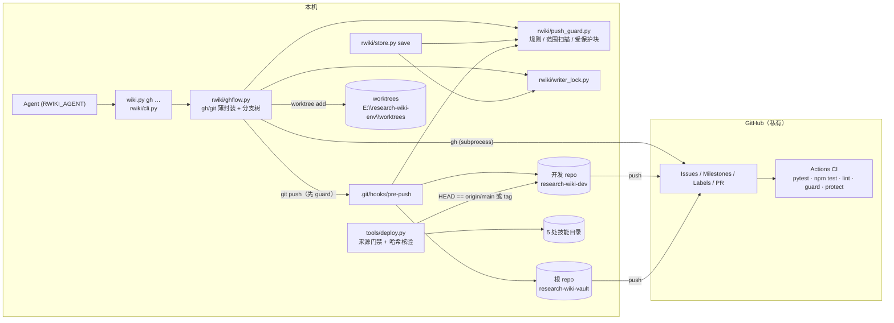

# Design Document

## Overview

本设计把 research-wiki 的任务、评审、验收从文件任务书迁到 GitHub（Milestone / Issue / PR），并让 agent 在门禁通过后自主合并。实现集中在 Wiki_CLI 新增的 `wiki.py gh` 子命令组，外加对 `store.save`、`config`、`lint` 与 `tools/deploy.py` 的小改动。

设计前核对过的现状（直接影响决策）：

- 根仓库 `E:\research-wiki` 在 `master` 上**已跟踪** `画廊/`（约 900 个文件）与 `维护记录/`（约 12 000 个文件），其中 607 个维护记录文件含本机绝对路径。现有历史不能原样推送。
- `知识库/methods/` 下 21 个方法页 `license: GPL-3`，`methods/scp-local-source/{code,source}/` 等目录存放 SCP 源码（含 `LICENSE.md`），属于 GPL SCP 源码。
- `开发` 仓库历史中 `config.json`、`codex/` 及 6 个测试/QA 文件含绝对路径；工作区有 111 个未提交改动。
- 本机全局 `core.autocrlf=true`；103 个知识库页含 `<!-- user:start -->…<!-- user:end -->` 作者块。
- `store.save` 用 `git -C <wiki_root> … -- .` 只暂存 wiki 子树；`server.py` 的写入端点也走 `save`。
- 两个本地仓库的分支都叫 `master`，需求要求 `main`。
- 测试依赖里没有 Hypothesis；需求禁止未经批准安装依赖。

### 关键决策

| # | 决策 | 理由 |
|---|------|------|
| D1 | 两个私有仓库：`research-wiki-dev`（`E:\research-wiki\开发`）与 `research-wiki-vault`（`E:\research-wiki` 根，含 `知识库/`、`文档/`、`tools/`、`research wiki/`、README）。`画廊/`、`维护记录/`（整体）、GPL 源码目录、`*.lnk`、`Rplots.pdf`、Project_Dir 均忽略。 | 开发与知识库生命周期不同；`deploy.py` 位于根仓库 `tools/`，跟随 vault。维护记录整体忽略而不只忽略"大体量"部分，因为其中 607 个文件含绝对路径，逐一清理收益低；Issue 只记其相对路径与哈希（R8.4/R13.4）。 |
| D2 | vault 的 `main` 是**孤儿快照**（一次提交，内容为过滤后的当前工作区）；旧 `master` 改名 `legacy/master` 只留本地。dev 的 `main` 由**过滤重放**生成：逐个重放 `master` 的提交（含 V5 分批提交），去掉被忽略路径，保留作者、时间与说明，并加 `Legacy-Commit: <sha>` trailer。 | vault 历史是大量 save 自动提交且含画廊，重放无价值；dev 只有 6+N 个提交，R5 要求分批历史可追溯。两者都只用 git 管道命令（临时 `GIT_INDEX_FILE` + `commit-tree`），不引入 filter-repo。**切换到新 `main` 只移动 HEAD 与索引**：`git symbolic-ref HEAD refs/heads/main` + `git read-tree main`，不用 `git switch`/`checkout`。旧 `master` 跟踪而新 `main` 未跟踪的文件（vault 的 `画廊/`、`维护记录/`；dev 的 `config.json`、`codex/`）普通检出会被从磁盘删除，且它们不在远端、不可恢复。此后主检出也不得检出 `legacy/master`。dev 历史中 6 个测试/QA 文件的绝对路径不在忽略范围内，重放后仍在历史里：由 preflight 的 guard 干跑列出，逐条写入 `.push-guard-allow`（带理由）或在重放时改写，二选一后才能首推。 |
| D3 | 根仓库切分支的影响：bootstrap 之后，`main`、长期分支与任务分支之间的 `git switch` 只改变已跟踪内容（`知识库/`、`文档/`、`tools/`、`research wiki/`），被忽略的 `开发/`、`画廊/`、`维护记录/`、GPL 目录不受影响；该前提只在两端分支都不跟踪这些目录时成立，因此从 `master` 过渡到 `main` 的那一次切换按 D2 用 `symbolic-ref` + `read-tree` 完成。主检出 `E:\research-wiki` 平时停在 `main` 作为阅读检出（Obsidian、launcher）。`start-task` 默认在主检出 `git switch`，仅允许 `知识库/` 内的未提交改动随行（作者在 Obsidian 的编辑由下一次 save 带入 PR），`知识库/` 之外有已跟踪改动时拒绝并列出。并行或用户正在使用 Obsidian 时用 `--worktree`。`文档/`、`tools/` 的改动不经 save，由 agent 在任务分支上用普通 git 提交；`finish-task` 在存在未提交的已跟踪改动时拒绝。 | save 只覆盖 wiki 子树，不能顺带提交其他目录；随行规则避免把文档草稿带到别的分支。 |
| D4 | Push_Guard 规则：单文件大小阈值默认 5 MB（`config.json` 的 `push_guard.max_file_mb`），对所有路径生效；绝对路径正则；GPL 检测 = 路径规则（GPL 方法页对应的 `code/`、`source/` 目录 + 可配 glob）+ 代码/LICENSE 文件头部许可标记；画廊路径；Project_Dir 路径（`wiki-use/_project/`）。仓库根的 `.push-guard-allow` 只能豁免 `abs-path` 与 `size` 两类规则，每条须写理由。 | 规则可解释、可在 CI 重放；版权图、GPL、课题数据不允许豁免。 |
| D5 | GPL 目录写入知识库 `.gitignore` 的托管块（`# >>> push-guard gpl` … `# <<< push-guard gpl`），由 `guard --sync-ignore` 生成，`save` 在 `git add` 前自动同步。 | save 用 `git add -A -- .`，不先忽略就会把新 GPL 代码提交进去。 |
| D6 | `.gitattributes` 在两个仓库都写 `* -text`（另列 `*.png *.pdf *.rds binary`）。 | 全局 `autocrlf=true` 会改写行尾；全仓库关闭转换最简单，且与"作者字节不被改写"一致。 |
| D7 | 受保护字节基准 `知识库/.protected-hashes.json` 记录每个文件每个作者块的 SHA-256（含行尾字节），由 `gh protect-baseline` 生成，`--check` 在 CI 校验。作者改了块时，agent 重新生成基准并在 PR"受保护字节核验"栏写明。 | 整文件哈希会因 agent 合法修改块外内容而误报；按块哈希只锁作者内容。 |
| D8 | `config.json` 含本机路径，改为不跟踪；仓库内提供 `config.example.json` 与 `ci/config.ci.json`。`deploy.py` 照旧要求部署副本与 staged `config.json` 字节相同。 | 本机绝对路径属于 Excluded_Content。 |
| D9 | CI 跑在 GitHub `windows-latest` 运行器，依赖只装在运行器上。vault CI 通过只读 deploy key（vault secret `DEV_DEPLOY_KEY`）检出 dev 的 `main` 来取得 `wiki.py`。 | 代码与测试面向 Windows 路径；deploy key 比 PAT 权限窄且可由 bootstrap 全自动创建。代价是私有仓库分钟数按 2 倍计。 |
| D10 | 个人免费私有仓库不支持分支保护。preflight 探测 `GET /repos/{o}/{r}/branches/main/protection`；返回 403 时进入本地门禁模式：`gh merge` 是唯一合并入口，pre-push hook 拒绝直接推送 `main`/`project/*`/`ingest/*`（新建长期分支且 sha 等于 `origin/main` 除外）。README 记录该替代方式。支持时 bootstrap 同时配置远端保护，本地门禁仍保留。 | R10.5。 |
| D11 | Codex 评审以 `gh pr review --comment` 回帖（同一账号不能 approve 自己的 PR，但可提交 COMMENT 类型 review），正文首行为 `<!-- codex-review: verdict=pass|changes sha=<sha> -->`。门禁取 reviews 与 comments 中最新的标记；`sha` 不等于 PR 当前 head 即失效。 | R9。 |
| D12 | 写入锁按 worktree：`<git-dir>/rwiki-writer.lock`（`git rev-parse --git-dir`，主检出即 `.git/`，worktree 即 `.git/worktrees/<名>/`）。`start-task` 建锁，task PR 合并后由 `gh merge` 释放。锁内 pid 只作信息，不做存活判断；遗留锁由用户手工删除。 | R7.4；不做猜测性的自动接管。 |
| D13 | `start-task --worktree` 在 `E:\research-wiki-env\worktrees\<分支名把 / 换成 __>` 执行 `git worktree add`，并为 GPL 托管块中的每个目录建 Windows 目录联接（`mklink /J`）指回主检出，使 worktree 内渲染与复核可用。wiki_root 覆盖顺序：`--wiki-root` > 环境变量 `RWIKI_WIKI_ROOT` > `config.json`。移除 worktree 前先逐个删除联接本身（`rmdir <联接>`，不带 `/s`，删除前用 reparse 属性确认它是联接），再 `git worktree remove`，且不加 `--force`。 | worktree 不含被忽略内容；联接只读引用 GPL 源码，不进 git。GPL 源码不在远端，误删不可恢复，所以联接必须先于 worktree 单独移除。 |
| D14 | `save` 分支策略：`main` 与长期分支拒绝；`task/*` 要求锁持有者 = `RWIKI_AGENT` 且锁分支 = 当前分支，提交附 trailer `Issue: #n`、`Agent: <名>`、`Pages: …`；其他分支（未迁移的旧仓库、测试仓库的 `master`）保持原行为，仅在设置了 `RWIKI_AGENT` 时附 `Agent`/`Pages`。Issue 号来自分支元数据。 | R7；不破坏未 bootstrap 的仓库和现有测试。 |
| D15 | `deploy.py` 门禁：`开发` 工作区干净（`git status --porcelain` 为空），且 HEAD 等于 `fetch` 后的 `origin/main`，或 HEAD 恰为一个已推送 tag。manifest 增加 `source_commit`、`source_tag`。新增 `--verify-only`：只比较 staged 与 5 处副本哈希，不写入、不检查门禁（V5 在首推前使用）。 | R12、R5.3。被忽略的 `app/` 构建产物与 `config.json` 不在 sha 覆盖范围内，manifest 照旧逐文件记录其哈希。 |
| D16 | `gh guard` 与 `gh protect-baseline` 不做 gh 前置检查：它们是纯本地 git 操作，在 pre-push hook 与 CI 中运行。其余子命令均先检查 gh。 | 已作为 R1.1 的显式例外写入需求：在 hook 中每次调用网络认证检查既慢又与离线拦截目标冲突。 |
| D17 | 属性测试用标准库 `random.Random(seed)` 生成输入，每个性质至少 100 次迭代，失败时打印 seed。 | 不引入 Hypothesis，本地与 CI 都能跑。 |
| D18 | 遗留迁移由 agent 先整理映射文件 `开发/review/legacy-map.json`（编号、文件、状态、结论、证据），`gh migrate-legacy` 按映射幂等执行，以 Issue 正文标记 `<!-- rwiki-legacy: id=T1 -->` 去重。任务书与评审记录在 `开发/review/`，Issue 建在 dev；`remaining-gaps.md` 的缺口按映射中 `repo` 字段归属，Milestone 用 `legacy/<来源目录名>`。 | 任务书格式不统一，自动判定"已完成"不可靠；映射文件让判定可评审。 |

已知影响：主检出停在 `main` 时，前端写入端点（`server.py` 的 `finish()` 在 `guarded()` 内调用 `save`）会被拒绝，页面改动由 `guarded()` 还原，`WikiError` 经现有异常处理返回给页面，信息为"请先 start-task"。UI 编辑需要让 server 指向任务分支所在的检出（launcher 传 `RWIKI_WIKI_ROOT`）。这一行为由 R7.2、R7.6 决定，Rule_Docs 按 R14.1 写明。

GitHub 上的 vault 不含被忽略的 GPL 源码目录、画廊与维护记录，影响两处：CI 的 `lint` 用 `--ci` 把这些缺失降为 `LOCAL-ONLY`（R11.5）；`--worktree` 用目录联接补齐 GPL 目录（D13，R7.7）。完整 lint 与方法复核只能在主检出或带联接的 worktree 中本地运行。

## Architecture



任务生命周期：

```mermaid
sequenceDiagram
    participant A as Agent
    participant W as wiki.py gh
    participant G as GitHub
    A->>W: start-batch ingest scp-wave3
    W->>G: milestone create "ingest/scp-wave3"
    W->>G: push ingest/scp-wave3（= origin/main）
    A->>W: start-task scp-wave3 P2 harmony --worktree
    W->>G: issue create（marker + milestone + labels）
    W->>W: branch/worktree + writer lock
    A->>A: wiki.py save …（trailers: Issue/Agent/Pages）
    A->>W: finish-task --local-report r.md
    W->>W: guard
    W->>G: push task/… ; pr create --base ingest/scp-wave3
    G->>G: CI
    A->>W: review <pr> --verdict pass --findings f.md
    W->>G: pr review --comment（codex-review marker）
    A->>W: merge <pr>
    W->>G: pr checks + 最新 marker sha == head ?
    W->>G: pr merge --merge --match-head-commit ; issue close
    W->>W: 释放锁、删 worktree 与本地分支
    A->>W: close-batch scp-wave3
    W->>G: 全部 Issue 已关闭 → pr create base main
```

## Components and Interfaces

所有模块沿用现有风格：模块级函数、`WikiError` 在 CLI 边界打印并返回 1、外部命令经 `rwiki.process.run`。

### rwiki/ghflow.py

```python
# 薄封装
def gh(args: list[str], cwd: Path) -> str            # run(["gh", *args], cwd).stdout
def gh_json(args: list[str], cwd: Path) -> object    # json.loads(gh([...,"--json",...]))
def git(repo: Path, *args: str) -> str               # 与 store.git 相同
def require_gh(cwd: Path) -> str                     # shutil.which("gh") + gh auth status + gh api user → login；
                                                     # 失败抛 WikiError，含安装链接与 `gh auth login`，不安装
def require_private(repo: Path) -> None              # gh repo view --json visibility；≠ PRIVATE 抛错并报实际值
def push(repo: Path, branch: str, rules) -> None     # require_private → push_guard.scan(本次范围) → git push -u origin

# 命名（纯函数）
STAGE = r"P[0-5]|T\d+"
SLUG  = r"[a-z0-9]+(?:-[a-z0-9]+)*"                  # ≤ 40 字符；中文标题写进 Milestone/Issue 标题
def long_branch(kind: str, name: str) -> str          # kind ∈ {project, ingest} → f"{kind}/{name}"
def task_branch(batch: str, stage: str, topic: str) -> str
def parse_task_branch(name: str) -> tuple[str, str, str]   # ^task/(SLUG)-(STAGE)-(SLUG)$；小写 slug 与大写阶段使解析唯一
# 非法时抛 WikiError，消息含合法示例：task/scp-wave3-P2-harmony、ingest/scp-wave3

# 分支元数据：<git-common-dir>/rwiki-branches.json（worktree 共享）
def read_meta(repo: Path) -> dict
def write_meta(repo: Path, meta: dict) -> None

# 子命令
def preflight(cfg) -> dict                            # 见下
def bootstrap(cfg, confirm: bool) -> dict
def start_batch(cfg, kind: str, name: str, title: str, repo_key: str) -> dict
def start_task(cfg, batch: str, stage: str, topic: str, title: str, worktree: bool) -> dict
def finish_task(cfg, local_report: Path | None) -> dict
def review(cfg, pr: int, verdict: str, findings: Path) -> dict
def merge(cfg, pr: int, plan: str | None) -> dict
def close_batch(cfg, batch: str) -> dict
def migrate_legacy(cfg, mapping: Path, dry_run: bool) -> dict

# 门禁（纯函数）
def render_review(verdict: str, sha: str, findings: list[str]) -> str
def parse_review_marker(text: str) -> tuple[str, str] | None
def gate_decision(checks: list[dict], entries: list[dict], head: str) -> tuple[bool, list[str]]
def open_issues_blocking(issues: list[dict]) -> list[dict]   # close-batch 用

# bootstrap 用的历史构造
def replay_filtered(repo: Path, source: str, target: str, excluded) -> int   # 返回重放提交数
def snapshot_orphan(repo: Path, target: str) -> str                          # 返回提交 sha
def install_hook(repo: Path) -> None                  # 写 pre-push：sys.executable + 本 wiki.py 绝对路径（hook 不入库）
```

子命令要点：

- 每个命令先确定仓库：`--repo dev|vault`（`start-batch` 必填，之后从元数据推断；默认 vault 用于 project/ingest，代码批次用 dev）。
- **幂等**：每步先查后建。Milestone 按标题查；Issue 按正文标记 `<!-- rwiki-task: branch=… -->` 查；PR 按 `gh pr list --head` 查；`merge` 若 PR 已合并则直接执行合并后步骤。中途失败后重跑即可续上。
- `start-batch`：从 `origin/main` 建长期分支 → Milestone（标题 = 分支名，描述 = 中文标题）→ `push`。
- `start-task`：解析批次 → 长期分支；建 Issue（模板正文、Milestone、`type:*`、`stage:*`、`status:进行中`）→ 主检出 `git switch -c`（D3 的随行规则）或 `--worktree` → 写元数据（`issue`、`worktree`）→ `writer_lock.acquire`。`--worktree` 时输出需要设置的 `RWIKI_WIKI_ROOT=…\知识库`。需要 `RWIKI_AGENT`。
- `finish-task`：拒绝未提交的已跟踪改动 → `push` → `gh pr create --base <长期分支> --body <PR 模板填充：Refs #n、本地专属验证 = local_report 内容、受保护字节核验 = protect-baseline --check 结果>` → Issue 标签改为 `status:待评审`。
- `review`：`gh pr view --json headRefOid` 取当前 head → `gh pr review <n> --comment --body render_review(...)` → 标签 `status:待评审`/`status:需修改`。
- `merge`：`gh pr checks --json name,bucket` + `gh pr view --json headRefOid,reviews,comments,baseRefName` → `gate_decision`。不通过：回帖 `<!-- rwiki-gate: blocked -->`、原因列表与 `--plan`（缺省写"待补"），退出 1。通过：`gh pr merge <n> --merge --match-head-commit <head> --delete-branch`。task PR 合并后：`gh issue close <n> --comment "合并于 #pr（sha）"`、标签 `status:已验收`、释放锁、先删 GPL 目录联接再 `git worktree remove`（D13，不加 `--force`）、删本地分支；主检出模式切回 `main` 并 `pull --ff-only`。长期分支 PR 合并后：关闭 Milestone（`gh api -X PATCH …/milestones/<n> -f state=closed`），删除长期分支。
- `close-batch`：`gh issue list --milestone <名> --state all --json number,title,state` → 有未关闭则拒绝并列出 → 否则 `gh pr create --base main --head <长期分支>`，正文列出 Milestone 内全部 Issue。
- `preflight` 输出 JSON：gh 路径/版本、认证账号、目标 owner、两仓库是否存在及可见性、分支保护是否可用、两个本地仓库的当前分支与未提交数、待推送范围（dev 重放的提交数与列表、vault 快照的文件数与总大小）、对待推送内容的 guard 干跑结果、`DEV_DEPLOY_KEY` 是否已设置。有阻断项时退出 1。
- `bootstrap`：无 `--confirm` 时等同 preflight 并提示需用户授权（R1.3），不做任何网络写操作。`--confirm` 依次：preflight 无阻断 → 校验 `.gitignore`/`.gitattributes`/`.push-guard-allow`/`.github/` 已存在（dev 已在 `chore(repo)` 提交中、vault 在工作区中），缺失即中止，保证它们进入新 `main` → 分支改名（`master`→`legacy/master`）→ 构造 `main`（D2）→ `symbolic-ref` + `read-tree` 切到 `main`，并核对原被跟踪的忽略目录仍在磁盘（文件数与切换前一致）→ `install_hook` → `gh repo create <owner>/<名> --private` → `git remote add origin` → `push main` → 创建 Label → 生成 ed25519 密钥（写 `E:\research-wiki-env\tmp`），公钥 `gh repo deploy-key add --read-only` 到 dev，私钥 `gh secret set DEV_DEPLOY_KEY` 到 vault，删除临时密钥 → 探测/配置分支保护 → 元数据记 `protection: github|local`。

### rwiki/push_guard.py

```python
@dataclass(frozen=True)
class Rules:
    max_file_bytes: int                  # push_guard.max_file_mb * 2**20，默认 5 MB
    gpl_globs: tuple[str, ...]           # 默认 ("**/SCP-local/**",)
    gpl_markers: tuple[str, ...]         # "GNU General Public License", "SPDX-License-Identifier: GPL",
                                         # "SPDX-License-Identifier: AGPL", "SPDX-License-Identifier: LGPL"
    gpl_dirs: tuple[str, ...]            # 由 GPL 方法页推导的 methods/<id>/code/、methods/<id>/source/
    allow: tuple[tuple[str, str], ...]   # (rule, glob)，只允许 abs-path / size

ABS_PATH = (r"(?<![A-Za-z0-9])[A-Za-z]:[\\/]",     # E:\  E:/  C:\Users  JSON 中的 E:\\
            r"(?<![\w.])/(?:Users|home)/[^/\s]+/")   # POSIX 家目录
CODE_SUFFIXES = {".r", ".py", ".c", ".cpp", ".h", ".hpp", ".js", ".ts", ".sh"}

def load_rules(cfg, repo: Path) -> Rules
def find_abs_paths(text: str) -> list[str]
def classify(path: str, size: int, added: list[str], head: bytes, rules: Rules) -> list[tuple[str, str]]
    # 规则 id：gallery（画廊/**）、project-data（任一层 wiki-use/_project/）、gpl-path、gpl-header
    # （仅 CODE_SUFFIXES 与 LICENSE* 文件，看前 4 KB）、size、abs-path（新增行；*.lnk 直接命中；二进制跳过）
def push_ranges(repo: Path, remote: str, updates: list[tuple[str, str, str, str]]) -> list[str]
    # 远端 sha 为全 0：f"{local} --not --remotes={remote}"；否则 f"{remote_sha}..{local}"
def scan(repo: Path, rev_range: str, rules: Rules) -> list[dict]
    # git log --format=%H --root -p -U0 --no-color --no-renames <range> + git diff-tree 取 blob 大小；
    # 逐提交检查，删除后的违规文件同样报告
def pre_push(repo: Path, remote: str, stdin: str) -> int
    # hook 入口：拒绝推送 legacy/*；本地门禁模式下拒绝更新 main/project/*/ingest/*
    # （新建长期分支且 sha == origin/main 除外；RWIKI_BOOTSTRAP=1 仅 bootstrap 内设置）；
    # 再对每个 ref 做 scan；命中则打印并返回 1
def gpl_method_dirs(wiki_root: Path) -> list[str]        # 读 methods/*.md frontmatter license ~ ^(A|L)?GPL
def sync_ignore(wiki_root: Path) -> bool                 # 重写 .gitignore 托管块，变化时返回 True

# 受保护字节
USER_BLOCK = re.compile(rb"<!-- user:start -->(.*?)<!-- user:end -->", re.S)
def user_blocks(data: bytes) -> list[bytes]
def baseline(wiki_root: Path) -> dict                    # 遍历 git ls-files 中的 *.md
def check_baseline(wiki_root: Path) -> list[str]         # 返回不一致描述；空表示通过
```

### rwiki/writer_lock.py

```python
def lock_path(wiki_root: Path) -> Path                    # Path(git rev-parse --absolute-git-dir) / "rwiki-writer.lock"
def acquire(wiki_root: Path, agent: str, branch: str) -> dict
    # 锁不存在则写入（O_CREAT|O_EXCL）；已由同一 agent+branch 持有则返回原锁；否则抛错并报持有者与分支
def read_lock(wiki_root: Path) -> dict | None
def require_holder(wiki_root: Path, agent: str, branch: str) -> None
def release(wiki_root: Path) -> None
```

### store.py 改动

```python
def save(config, message):
    ...  # refresh_facts / index 不变
    branch = git(root, "branch", "--show-current").strip()
    policy = save_policy(branch)                    # 纯函数："refuse-main" | "refuse-long" | "task" | "plain"
    # refuse-*：抛 WikiError（"main 上不写入，请先 wiki.py gh start-task"），此时尚未写 log.md；
    #           guarded() 负责还原调用方已写的页面
    # task：writer_lock.require_holder(root, os.environ["RWIKI_AGENT"], branch)；Issue 号取自元数据
    push_guard.sync_ignore(root)
    ...  # status 为空直接返回 / 写 log / git add -A -- .  不变
    pages = git(root, "diff", "--cached", "--name-only", "--relative", "--", ".").split()
    git(root, ..., "commit", "-m", message, "-m", trailers(issue, agent, pages), "--", ".")

def trailers(issue: int | None, agent: str | None, pages: list[str]) -> str
    # "Issue: #12\nAgent: codex\nPages: methods/a.md, templates/b.md"；超过 20 个页面时列前 20 个并写 "… (+N)"
```

### config.py / cli.py / lint.py 改动

- `Config` 增加 `push_guard: dict` 与 `github: dict`（`owner`、`dev_repo`、`vault_repo`、`dev_root`、`vault_root`、`worktree_root`），缺省为空字典，由使用方填默认值。
- `load_config(path, wiki_root=None)`：覆盖顺序 `--wiki-root` > `RWIKI_WIKI_ROOT` > 文件值。
- `parser()` 增加全局 `--wiki-root`、`lint --ci`、`gh` 子命令组：

| 子命令 | 参数 | 前置条件 |
|---|---|---|
| `preflight` | — | gh 可用 |
| `bootstrap` | `[--confirm]` | preflight 无阻断；`--confirm` 需用户授权 |
| `start-batch` | `<project\|ingest> <名称> --title <中文标题> --repo dev\|vault` | 已 bootstrap |
| `start-task` | `<批次> <阶段> <主题> --title … [--worktree]` | 批次存在；`RWIKI_AGENT` 已设置 |
| `finish-task` | `[--local-report <文件>]` | 在 task 分支；无未提交的已跟踪改动 |
| `review` | `<pr> --verdict pass\|changes --findings <文件>` | PR 存在 |
| `merge` | `<pr> [--plan <文本>]` | — |
| `close-batch` | `<批次>` | Milestone 内 Issue 全部关闭 |
| `migrate-legacy` | `--map <legacy-map.json> [--dry-run]` | 首次推送完成 |
| `guard` | `[--range <rev-range>] [--pre-push <remote> <url>] [--sync-ignore]` | 无（D16） |
| `protect-baseline` | `[--check]` | 无（D16） |

- `lint --ci`：缺失文件若被 vault 忽略（`git check-ignore` 命中：GPL 托管块、`画廊/`、`维护记录/`），报告为 `LOCAL-ONLY` 行而不是 `ERROR`；未被忽略的缺失仍为 `ERROR`。

### tools/deploy.py 改动

```python
def source_gate() -> dict   # git -C 开发 status --porcelain 为空；git fetch origin；
                            # HEAD == origin/main → {"commit": sha, "tag": None}
                            # 否则 git describe --exact-match --tags HEAD 且 git ls-remote --tags origin <tag> 有结果
                            # → {"commit": sha, "tag": tag}；都不满足则 sys.exit(当前分支、HEAD、origin/main)
def verify_only() -> int    # 打印 5 处副本与 staged 的差异清单；不一致返回 1
```

`main()` 先调用 `source_gate()`，manifest 增加 `source_commit` 与 `source_tag`；备份与逐文件哈希核验保持不变。用法变为 `deploy.py <record> "<note>"` 或 `deploy.py --verify-only`。

### 仓库文件

- `.github/workflows/ci.yml`（dev）：`on: pull_request`（所有分支）与 `push: [main]`；`actions/checkout`（`fetch-depth: 0`）→ setup-python → `pip install -r staged/research-wiki/requirements.lock.txt` → `pytest -m "not r and not compose and not local"` → `npm ci && npm test`（`frontend/`）→ 用 `wiki.py --config ci/config.ci.json --wiki-root $RUNNER_TEMP/w init` 生成夹具 wiki 再 `lint` → `wiki.py gh guard --range origin/${{ github.base_ref }}..HEAD`。
- `.github/workflows/ci.yml`（vault）：检出 vault（`fetch-depth: 0`，guard 的范围需要基线分支）与 dev（`ssh-key: ${{ secrets.DEV_DEPLOY_KEY }}`，`ref: main`）→ `pip install` → `wiki.py --config 开发/ci/config.ci.json --wiki-root 知识库 lint --ci` → `gh guard --range …` → `gh protect-baseline --check` → `pytest tools/tests`（deploy 门禁测试）。
- `.github/pull_request_template.md`：关联 Issue / 改动摘要 / 测试结果（CI）/ 本地专属验证 / 受保护字节核验 / 未完成项。
- `.github/ISSUE_TEMPLATE/task.md`：见数据模型。
- `pytest.ini` 增加 marker `local: 需要本机路径、真实画廊或本地证据`；现有含绝对路径的测试按内容标记 `local`，或改用 `tmp_path`。

### 仅本地运行的检查（R11.2）

| 检查 | 原因 |
|---|---|
| `verify-template` / `verify-layout` / `render`（`@pytest.mark.r`） | 需 `D:\R-4.5.0` 的 Rscript 与本机 R 包 |
| panel 合成（`@pytest.mark.compose`） | 需 sci-figure-replica venv |
| 方法复核回执重放（`check-entry` 涉及 runtime、`verification/*.json` 所指命令） | 依赖 `E:\research-wiki-env\sources` 数据与被忽略的 GPL 源码 |
| 真实画廊读取（`ingest-figure`、`test-gallery*`） | 画廊受版权保护，不入库 |
| `frontend/tests/real-taxonomy.ts` | 读本机 taxonomy |
| `deploy.py` 5 处部署与 `--verify-only` | 操作本机技能目录 |
| 浏览器检查（`qa/cdp.mjs`） | 需本机浏览器与运行中的 server |

agent 在 PR 涉及上述范围时本地运行，把摘要写进报告文件，再由 `finish-task --local-report` 填入 PR。

### V5 分批提交流程（首推前一次性执行）

0. **在本特性任何代码改动之前**记录 blob 基线：`git status --porcelain -uall -z` 列出 `开发` 的全部未提交文件，对存在的文件 `git hash-object -w` 写入对象库，删除项记为删除，结果存 `E:\research-wiki-env\tmp\v5-baseline.json`（路径 → 状态、blob sha、字节数）。不改工作区与索引。之后本特性的改动会叠在同一批文件上，主题提交只能靠该基线还原 10-23 至 10-26 的内容。
1. 列出基线中的未提交文件（本特性实现后也可用 `wiki.py gh preflight` 查看，但分组以基线为准）。
2. agent 写计划 `E:\research-wiki-env\tmp\v5-plan.json`：`{"themes": {"方法族": [...], "最小运行闭包": [...], "taxonomy/输入绑定": [...], "课题状态层": [...]}, "unassigned": [...]}`。
3. `unassigned` 非空 → 列出文件并暂停，等待用户决定（R5.4）。本工作流只在三处停下等用户：此处、bootstrap 授权、以及需绕过本地 hook 的 CI 拦截验证 PR。本特性自身的新改动归入 `github-workflow` 组，不算 unassigned。
4. 依次按主题提交：用基线 blob `git update-index --cacheinfo <mode>,<sha>,<路径>`（删除项用 `--remove`）暂存，提交前确认 `git diff --cached --name-only` 恰为该主题文件，说明格式为 `feat(<主题>): <摘要>`，正文列出主要文件。之前任何步骤都不得改动索引。
5. 提交 `feat(github-workflow)`（本特性代码、测试、规则文档、`review/legacy-map.json`）与 `chore(repo)`（`git rm --cached staged/research-wiki/config.json`、新增 `config.example.json`、`ci/config.ci.json`、`.gitattributes`、`.gitignore`、`.push-guard-allow`、`.github/`）。
6. `python tools/deploy.py --verify-only` 报告一致或差异清单；预期差异只来自 `github-workflow` 组文件（部署副本仍是 10-26 的版本），其余差异逐条说明。然后才进入 bootstrap。

## Data Models

`config.json` 新增（不入库，示例在 `config.example.json`）：

```json
{
  "push_guard": {"max_file_mb": 5, "gpl_globs": ["**/SCP-local/**"]},
  "github": {"owner": "<login>", "dev_repo": "research-wiki-dev", "vault_repo": "research-wiki-vault",
             "dev_root": "E:\\research-wiki\\开发", "vault_root": "E:\\research-wiki",
             "worktree_root": "E:\\research-wiki-env\\worktrees"}
}
```

CI 使用的配置不含 `push_guard`，因此走默认值；本地如果改了阈值，本地与 CI 两次检查都会执行，实际生效的是更严的那一个。

分支元数据 `<git-common-dir>/rwiki-branches.json`（本地，可由 GitHub 上的标记重建）：

```json
{"protection": "local",
 "batches": {"scp-wave3": {"kind": "ingest", "branch": "ingest/scp-wave3", "milestone": 7, "title": "SCP 第三批"}},
 "tasks": {"task/scp-wave3-P2-harmony": {"batch": "scp-wave3", "stage": "P2", "topic": "harmony",
           "issue": 41, "worktree": "E:\\research-wiki-env\\worktrees\\task__scp-wave3-P2-harmony", "pr": 52}}}
```

写入锁 `<git-dir>/rwiki-writer.lock`：

```json
{"agent": "codex", "branch": "task/scp-wave3-P2-harmony", "pid": 12345, "timestamp": "2026-10-27T03:12:00+00:00"}
```

评审标记（PR review 正文首行）：`<!-- codex-review: verdict=pass sha=3f2c…40位 -->`，随后为结论、问题列表、所评审的 SHA 的可读版本。门禁阻断评论：`<!-- rwiki-gate: blocked sha=<head> -->` + 原因 + 修复计划。

受保护基准 `知识库/.protected-hashes.json`：

```json
{"version": 1, "files": {"methods/batch-integration.md": ["<sha256 of block 1 bytes>", "…"]}}
```

`.push-guard-allow`（仓库根，入库）：每行 `<rule> <glob>  # 理由`，例如 `abs-path 知识库/**/verification/**  # 本地复核回执，路径即证据定位`；`rule` 只能是 `abs-path` 或 `size`，其他取值使 guard 报错。

Label 方案（bootstrap 用 `gh label create --force` 写入两个仓库）：

| 组 | Label |
|---|---|
| 类型 | `type:project`、`type:ingest`、`type:code`、`type:legacy` |
| 阶段 | `stage:P0`…`stage:P5`、`stage:T1`…`stage:T9`（T 系列按需追加）、`stage:legacy` |
| 状态 | `status:进行中`、`status:待评审`、`status:需修改`、`status:已验收` |
| 阻塞 | `blocked:用户决定`、`blocked:本地验证`、`blocked:外部依赖`、`blocked:CI` |

Milestone 命名：与长期分支同名（`project/<课题>`、`ingest/<批次>`）；遗留迁移用 `legacy/<来源目录名>`。

Issue 正文模板：

```markdown
<!-- rwiki-task: branch=task/scp-wave3-P2-harmony batch=scp-wave3 stage=P2 -->
## 目标
## 验收标准
- [ ] …
## 本地证据
| 相对路径 | sha256 |
|---|---|
## 验收结论
（合并时填写：结论、PR、合并 SHA）
```

遗留映射 `开发/review/legacy-map.json`：

```json
{"items": [{"id": "T3", "repo": "dev", "title": "…", "files": ["review/T3-review.md"], "state": "closed",
            "conclusion": "…", "evidence": [{"path": "维护记录/2026-10-21-…/x.json", "sha256": "…"}]}],
 "gaps": [{"id": "gap-1", "repo": "vault", "milestone": "legacy/SCP持续入库与新规则", "title": "…", "body": "…"}]}
```

迁移标记（原文件顶部，置于原字节之前）：

```markdown
<!-- rwiki-migrated: issue=https://github.com/<owner>/research-wiki-dev/issues/12 -->
> 已迁移，停止维护：https://github.com/<owner>/research-wiki-dev/issues/12

```

deploy manifest 新增：`"source_commit": "<sha>", "source_tag": "v2026.10.27" | null`。

## Error Handling

- 所有失败抛 `WikiError`，由 `cli.main` 打印到 stderr 并返回 1，与现有命令一致。gh/git 的非零退出由 `process.run` 转成带命令与 stderr 末 20 行的 `WikiError`，不再另包。
- gh 缺失或未认证：消息包含 gh 安装页地址与 `gh auth login`，不尝试安装（R1.2）。
- 可见性不是 PRIVATE：在任何 `git push` 之前抛错并报实际可见性（R1.4）。
- guard 命中：打印 `<rule>\t<path>\t<commit>\t<detail>` 列表，hook 返回 1，wrapper 抛错；不提供跳过参数。
- 命名非法、批次不存在、close-batch 有未关闭 Issue、锁被他人持有、main 或长期分支上 save：抛错并给出下一步（合法示例、未关闭列表、持有者与分支、`start-task`）。
- 门禁不通过：PR 保持未合并，回帖原因与计划，退出 1（R10.3）。
- 多步命令中途失败不回滚远端对象；靠标记查重做到重跑续做（见 ghflow 要点）。本地破坏性操作只有分支改名、`worktree remove` 与删除已合并分支，均可从 `legacy/master` 或远端恢复。
- `save` 被拒时发生在写 `log.md` 与 `git add` 之前；页面写入由现有 `guarded()` 还原。
- `deploy.py` 保持脚本风格：门禁失败 `sys.exit(原因)`，哈希不一致仍用 `assert`。

## Testing Strategy

- 框架：pytest，测试在 `staged/research-wiki/tests/`（`test_ghflow.py`、`test_push_guard.py`、`test_writer_lock.py`、`test_store_branch.py`），deploy 门禁测试在 vault `tools/tests/test_deploy.py`。
- 真实 git：每个测试在 `tmp_path` 下建工作仓库与 `--bare` 远端，设置 `core.autocrlf=true` 复现本机环境；不 mock 文件系统。
- 假 gh：`tests/fake_gh/gh.py` + `gh.cmd`，通过 `monkeypatch.setenv("PATH", …)` 放到 PATH 最前；从 `FAKE_GH_STATE` 指向的 JSON 读取场景（账号、可见性、Issue/PR/checks/reviews），把每次 argv 追加写入 `FAKE_GH_LOG`，测试断言调用序列并在需要时更新状态。
- 属性测试：标准库 `random.Random(seed)` 生成器，每个性质 ≥ 100 次迭代，失败信息包含 seed；每个测试的 docstring 带标签 `Feature: github-structured-workflow, Property <n>: <标题>`。
- 示例测试：gh 三态（R1.1/1.2）、`guard`/`protect-baseline` 在 PATH 无 gh 时仍可运行（R1.1 例外）、main 上经 `server.py` 写入被拒且页面还原（R7.6）、worktree 联接可读且移除 worktree 后联接目标完好（R7.7）、bootstrap 切到 `main` 后原跟踪的忽略目录仍在磁盘、bootstrap 无 `--confirm` 不发网络写（R1.3）、PUBLIC/INTERNAL 拒推（R1.4）、hook 与 wrapper 各自拦截（R3.3）、PR/Issue 模板小节、`--worktree` 双 worktree、合并后清理、403 进入本地门禁模式、`lint --ci` 对缺失 GPL 目录不报 ERROR、规则文档包含全部子命令且不再含"提交到 master"。
- 集成（GitHub 上一次性）：首个 PR 观察 CI 检查项；一个故意含违规文件的测试 PR 应失败（R3.4、R11.1）；preflight 探测分支保护（R10.1）。
- 本地专属检查按上表运行，不进 CI。

## Correctness Properties

*A property is a characteristic or behavior that should hold true across all valid executions of a system-essentially, a formal statement about what the system should do. Properties serve as the bridge between human-readable specifications and machine-verifiable correctness guarantees.*

### Property 1: 分支命名往返与拒绝

*For any* 合法的 slug 批次名、阶段（P0–P5 或 T 系列）与 slug 主题，`parse_task_branch(task_branch(b, s, t)) == (b, s, t)`，且 `long_branch(kind, b)` 等于所建 Milestone 的标题；*for any* 不满足命名规则的字符串（含大写 slug、空格、中文、阶段越界、缺段），`start-batch`/`start-task` 拒绝执行、不创建任何分支或 GitHub 对象，错误信息含合法示例。

**Validates: Requirements 6.1, 6.2, 6.5**

### Property 2: 规则分类与参考模型一致

*For any* 文件路径、大小、新增行与文件头字节的组合，`classify` 返回的规则集合等于参考模型给出的集合（画廊、Project_Dir、GPL 路径、GPL 头部标记、超限大小、绝对路径）；*for any* `.push-guard-allow` 内容，豁免只会去掉 `abs-path` 与 `size` 命中，画廊、GPL、Project_Dir 命中始终保留。

**Validates: Requirements 3.2, 15.3**

### Property 3: 推送范围扫描完备

*For any* 提交序列，其中某些中间提交加入违规文件、之后的提交又删除或改写它，`scan` 对该推送范围报告的（路径, 规则）集合包含每个曾被加入的违规文件，且只要报告非空，推送就不会到达远端（远端 ref 不变）。

**Validates: Requirements 3.1, 3.2**

### Property 4: 字节保真

*For any* 文件字节内容（LF、CRLF、混合行尾、BOM、无末尾换行），在 `core.autocrlf=true` 的仓库中按本设计的 `.gitattributes` 提交，再克隆或检出后，文件字节与提交前完全相同。

**Validates: Requirements 4.1, 4.2**

### Property 5: 作者块基准只锁作者内容

*For any* 含任意个 `<!-- user:start -->…<!-- user:end -->` 块的页面集合，`baseline` 后立即 `check_baseline` 返回空；对任意一处字节修改，`check_baseline` 非空当且仅当修改位置落在某个作者块内部（含行尾字节变化）。

**Validates: Requirements 4.3**

### Property 6: close-batch 只在全部关闭时开 PR

*For any* Milestone 内 Issue 的开/关状态组合，`close-batch` 创建到 `main` 的 PR 当且仅当全部 Issue 已关闭；否则不创建 PR，且报告的未关闭列表恰好等于实际未关闭的 Issue 集合。

**Validates: Requirements 6.4, 6.6**

### Property 7: save 分支策略与子树范围

*For any* 分支名与 wiki 内外的改动组合，`save` 的结果符合策略模型：`main` 与 `project/*`、`ingest/*` 上拒绝且 HEAD、`log.md` 不变；`task/*` 上在锁持有者匹配时提交到当前分支；产生的提交只包含 wiki 子树路径，wiki 之外的改动保持未提交。

**Validates: Requirements 7.1, 7.2, 15.2**

### Property 8: 提交 trailer 往返

*For any* 页面路径集合（含中文与空格）、Issue 号与 Agent 名，`save` 生成的提交经 `git interpret-trailers --parse` 解析后，`Issue`、`Agent` 与原值相等，`Pages` 等于实际暂存的页面路径（超过 20 个时为前 20 个加余数计数）。

**Validates: Requirements 7.3**

### Property 9: 写入锁排他

*For any* 多个 Agent 交替执行 acquire 与 save 的操作序列，在同一 worktree 中只有锁持有者的 save 成功；其他 Agent 的每次尝试都被拒绝，错误中报告当前持有者与分支，且不产生提交。

**Validates: Requirements 7.4**

### Property 10: 证据只以相对路径与哈希出现

*For any* 证据列表（路径位于 Excluded_Content 下），渲染出的 Issue 正文包含每条证据的相对路径与 sha256，且 `find_abs_paths` 在正文上返回空。

**Validates: Requirements 8.4, 13.4**

### Property 11: 评审标记往返

*For any* 结论（pass/changes）、40 位提交 SHA 与问题列表，`parse_review_marker(render_review(v, sha, findings)) == (v, sha)`，且正文包含每一条问题。

**Validates: Requirements 9.2**

### Property 12: 合并门禁判定

*For any* checks 列表、按时间排列的 review/comment 序列与 PR head SHA，`gate_decision` 返回通过当且仅当：checks 非空且全部为 pass，最新一条 codex-review 标记的结论为 pass，且其 sha 等于 head；不通过时原因列表非空，`merge` 不调用 `gh pr merge`。

**Validates: Requirements 9.3, 10.2, 10.3**

### Property 13: 部署来源判定

*For any* （工作区是否干净、HEAD、origin/main、HEAD 上的 tag 及其是否已推送）组合，`source_gate` 允许部署当且仅当工作区干净且（HEAD 等于 origin/main，或 HEAD 恰有一个已推送 tag）；拒绝时不写入任何技能目录，并报告当前分支与提交。

**Validates: Requirements 12.1, 12.2**

### Property 14: 遗留迁移幂等

*For any* 遗留映射表（任务书与缺口、开/关状态混合），连续执行两次 `migrate-legacy` 后，每个映射项恰好对应一个 Issue，其开关状态与映射一致，缺口 Issue 均为打开并归入指定 Milestone。

**Validates: Requirements 13.1, 13.2**

### Property 15: 迁移标记幂等且保留原字节

*For any* 原任务书文件字节，加迁移标记一次或多次后，标记头只出现一次，去掉标记头后的字节与原文件完全相同。

**Validates: Requirements 13.3**
