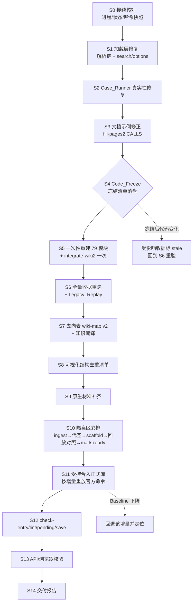
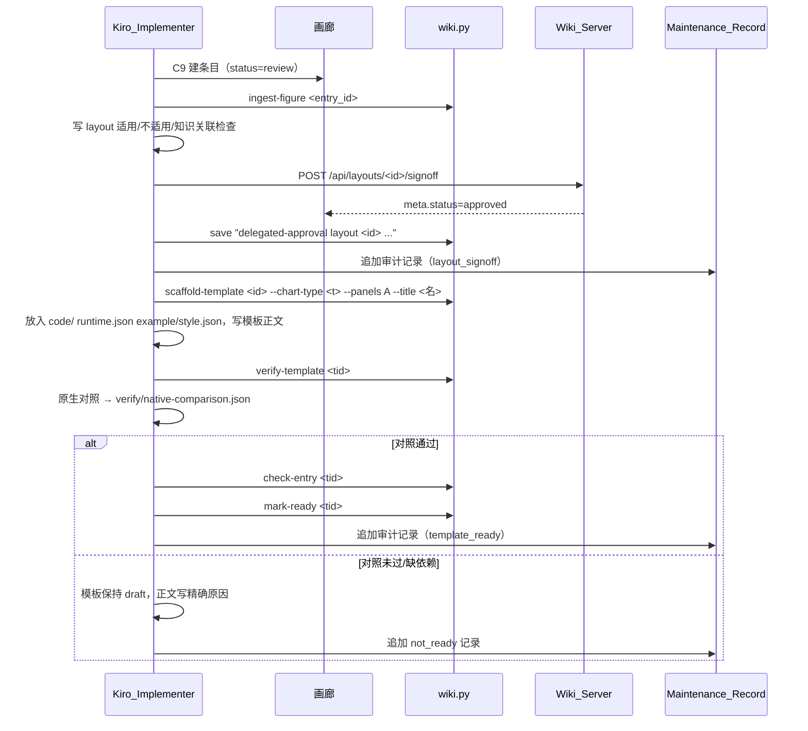

# 设计文档：SCP 全库入库（scp-full-ingest）

## Overview

本设计把 requirements.md 的 16 条需求落成一条可审计、可回退的执行链。起点是上一轮留在隔离工作区 B 的磁盘成果，不从零盘点、不重写生成器；终点是正式库 A 的受控增量合入、前端实查和交付报告。

已实际读过并作为设计依据的材料：

- 接续点与交接：`维护记录/2026-10-25-SCP全库入库/codex-independent-checkpoint-20261026T0830.md`、`codex-finalize10-live-review.md`、`B/codex-finalize10-handoff.md`。
- 覆盖数据：`B/coverage/exports.json`（142 行，含 classification、source_location、next_state）、`B/coverage/modules-index.json`（79 行，含 module/entry/cls/required/optional/ensure/dropped_installers）、`B/coverage/branches.json`（286 个具名形态，字段 owner/parameter/branch/dispatch_target/branch_dep/dep_state）。
- 生成与执行脚本：`B/scripts/assemble-modules3.py`（MODULE_R 模板）、`B/scripts/run-iso-case.py`（driver 生成与收据判定）、`replay-legacy.py`。
- 产品规则与代码：`开发/staged/research-wiki/SKILL.md`、`references/minimal-runtime.md`、`code-assets.md`、`input-binding.md`；`rwiki/cli.py`、`ingest.py`、`templates.py`、`verification.py`、`acceptance.py`、`method_implementations.py`、`server.py`；正式库 `AGENTS.md`；`sci-figure-replica/SKILL.md` 与 `references/gallery-layout.md`。
- 正式库现状：`知识库/templates/` 下 17 个 SCP 模板全部 `status: ready`；fig17 资产含 `runtime.json`、`spec.json`、`verify/{verify.json,native-comparison.json,runtime-portability.json,comparison.md}`、`acceptance.json`。

### 读代码后确认的关键事实（影响设计）

| 事实 | 出处 | 设计影响 |
|---|---|---|
| `MODULE_R` 已含 `parent.env(environment()) <- baseenv()`、`imports` 父环境为 `baseenv()`、detach 重试循环 | `assemble-modules3.py` 第 350–530 行 | 加载层不是从零修，而是核对已构建模块是否由该模板生成、补齐标准包符号绑定与 options 分类，再用探针证明 |
| `baseenv()` 的父环境是 `globalenv()`，未显式绑定的自由符号仍会落到作者全局环境 | R 语义 | 受控解析链的缺口只剩"未进 imports 的标准包/导入符号"；用"全符号遮蔽探针"闭合 |
| 现行 on.exit 保留所有新增 options，不区分 namespace 初始化默认项与算法临时项 | 同上第 515–525 行 | 需求 5.6/5.8 未满足，需新增分类逻辑 |
| `run-iso-case.py` 已拒绝"仅 hygiene 即 passed"，但 `returns_ggplot`、`plotly_build_ok` 仍被算作非 hygiene 证据；代码哈希只在运行后采集一次；`command` 为 `cd <tdir> && Rscript driver.R`；期望报错用例被记为 passed | `run-iso-case.py` 第 270–390 行 | 需求 7.1–7.5 未闭合，需改为证据白名单、前后双采哈希、完整可重放命令、守卫用例单列 |
| Wiki CLI 没有签核子命令；签核只有网页 API `POST /api/layouts/{id}/signoff`，会同时把画廊 `meta.json` 改为 approved | `server.py` 第 376–389 行 | 代签核必须经运行中的 Wiki_Server API 执行，不手改 frontmatter 或画廊 meta |
| `POST /api/{kind}/{id}/note` 写的是 `<!-- user -->` 区块 | `server.py` | 审计记录禁止走该接口，改写 agent 正文节并经 `save` 进 log |
| `scaffold-template` 要求 layout 为 `pending_template`，把画廊 `data/*.csv` 复制为 `example/`，模板 id 固定为 `<layout-id>--<chart-type>`，语言取画廊 meta | `templates.py` 第 48–110 行 | 画廊条目的 `data/` 必须就是"准备好的结果表"；每个结构一个画廊条目 |
| `verify-template` 必须产出 `figure.png/pdf/svg` 三件且非空；`mark-ready` 要求 `replay_available` 与 `entry_errors` 为空 | `templates.py`、`verification.py`、`acceptance.py` | 交互/3D 只有 HTML 输出时无法通过官方回放门槛，只能保留非 ready 并写原因 |
| sci-figure-replica 的适用范围写明不适用于"3D/动画/交互图"，但这是文档范围说明，脚本里没有 3D 检查；脚本层的硬性拒绝只有 `init_entry.py` 的"来源必须是 PNG"（`T1 entry source must be PNG`）；`ingest-figure` 只检查 `panel_map` 恰好一项与缩略图，不检查图型维度 | `sci-figure-replica/SKILL.md` 第 6 行、`scripts/init_entry.py`、`rwiki/ingest.py` 第 110–155 行 | 按作者决定，两个 3D 结构照样建条目与模板：来源 PNG 用原生 HTML 的浏览器截图（注明仅为来源参考图），模板停在 draft，见 C10.3 与 R1 |
| 现有环境没有 hypothesis（D:/anaconda 与 research-wiki venv 均无），R 侧无 quickcheck/hedgehog；需求 13.8 禁止安装 | 本轮实测 | 不安装 hypothesis；组合性质用标准库 `random.Random(seed)` 固定种子生成，有限对象全集穷举，见测试策略 |
| 现有环境有 testthat、codetools、digest、jsonlite、svglite、plotly、htmlwidgets、png；无 webshot2/kaleido、metR、concaveman | `codex-r-presence.json` 与本轮实测 | 决定哪些结构可产出原生材料、哪些模板必然非 ready |

### 用户最新决定的落点

作者 2026-10-26 授权 Kiro_Implementer 代签核本轮全部 SCP 图样（方案 A）。设计把"代签核"拆为两个官方动作并分别留审计：

1. 来源签核：对新 layout 调用 `POST /api/layouts/{id}/signoff`（layout `pending_signoff → pending_template`，画廊 `approved`）。
2. 模板确认：回放与原生对照实际通过后调用 `wiki.py mark-ready <template-id>`（模板 `draft → ready`）。

两个动作都只在有原生对照证据时执行；原生函数失败的结构不做第 1 步，回放未过的模板不做第 2 步。

作者对两个 3D 结构（CellDimPlot3D、FeatureDimPlot3D）的决定：建成模板，停在 draft。照样走 ingest-figure → 代签核 → scaffold-template；模板正文写明"交互输出，官方回放（PNG/PDF/SVG）不支持，未 ready"的精确原因；对照证据用 plotly trace 字段比对、外部 `plotly_build` 与 HTML 保存、实际浏览器渲染与图例隐藏/恢复交互检查。不执行 `mark-ready`，不放宽任何 validator。具体做法见 C10.3。

性质测试的决定：不安装 hypothesis，用标准库 `random.Random(seed)` 固定种子生成输入，每条组合性质至少 100 次迭代，失败信息含 seed；有限对象全集穷举检查。见测试策略。

## Architecture

### 总体阶段



### 阶段边界与进入/退出条件

| 阶段 | 进入条件 | 退出条件（写入 Maintenance_Record 的证据） | 需求 |
|---|---|---|---|
| S0 接续核对 | 无 | `kiro-s0-takeover-<stamp>.json`：psutil 精确命令行核对无 Devin/测试进程；`task-state.json` 编码负责人=Kiro_Implementer；B 与 A 关键文件哈希快照 | 1.1–1.4 |
| S1 加载层修复 | S0 通过 | 全符号遮蔽探针、search/options 探针、MDS/NMF/Graph/3D 新进程回归全部通过 | 4.x、5.x |
| S2 Case_Runner 修复 | S1 通过 | 判定函数单测与性质测试通过；旧收据不改写 | 7.1–7.7 |
| S3 文档示例修正 | S2 通过 | `codex_doc_calls_audit.py` 新时间戳零违规；所有示例可 `parse` | 11.x |
| S4 Code_Freeze | S1–S3 全过 | `code-freeze-<stamp>.json`：79 模块、family `code/`、helper、resources、runtime.json 全部 sha256 | 9.2 |
| S5 重建整合 | S4 | 只执行一次 assemble + integrate；重建后哈希与冻结清单一致 | 9.2 |
| S6 收据重跑 | S5 | 每个分支一条现行收据（passed 或精确 not_run）；Legacy_Replay 新结果；79 模块加载审计 | 7.x、8.x、9.3–9.7、15.x |
| S7 去向表 | S6 | `coverage/wiki-map.json` v2 校验器零错误；人读对照表 | 2.x、3.x |
| S8 结构清单 | S7 | `coverage/visual-structures.json` 每项有去重判定 | 10.1 |
| S9 原生材料 | S8 | 每个新增结构有原生 PNG/SVG（或 HTML）+ 调用脚本 + 哈希，或精确原生失败/缺包记录 | 8.2、8.6、10.5、10.12 |
| S10 隔离彩排 | S9 | 隔离 Wiki 中每个可行结构走完 ingest→代签→scaffold→verify→对照→mark-ready；审计 JSONL | 10.2–10.11 |
| S11 合入 | S10 + 合入前 Baseline 快照 | 增量逐个合入、逐个比对；备份路径记录 | 12.x、13.1–13.5 |
| S12 验收命令 | S11 | `check-entry --record`、`lint` 无 ERROR、`pending --json`、`save` | 13.6–13.7 |
| S13 前端核验 | S12 | API 状态与 CLI 一致；浏览器检查记录与截图路径 | 14.x、8.7、10.13 |
| S14 交付 | S13 | 交付报告含六类清单与全部未闭合项 | 15.6–15.7 |

### 写入边界

| 区域 | S0–S10 | S11–S13 |
|---|---|---|
| B（隔离工作区） | 读写 | 只读 |
| A 维护记录 | 只追加新时间戳文件；不改历史证据 | 只追加 |
| 正式 Wiki（`E:/research-wiki/知识库`） | 只读 | 仅经官方 CLI/API 与合入脚本写入增量 |
| 正式画廊（`E:/research-wiki/画廊`） | 只读 | 仅新增 `2026-10-22-scp-example/figures/fig18+` 新目录、签核 API 改新条目 meta、`build_index.py` 重建索引 |
| Fixed_Source、正式开发代码 `开发/staged` | 只读 | 只读 |
| 临时文件 | `E:/research-wiki-env/tmp/kiro-scp-*` | 同左 |

## Components and Interfaces

### C1 接续核对器 `B/scripts/kiro_takeover_check.py`

- 用 `D:/anaconda/python.exe -X utf8` 运行（该环境有 psutil）。
- 枚举全部进程，匹配命令行含 `devin`、`cuddly-custard`、`devin_acp_client.py`、`run-family-cases.py`、`run-iso-case.py`、`Rscript` 且 cwd/参数含 B 路径的进程；输出 pid、ppid、完整命令行、创建时间。
- 发现匹配进程即退出码 2 并停止，不写 B（需求 1.2）。
- 无匹配时更新 `A/task-state.json`：追加 `{"owner": "Kiro_Implementer", "since": <UTC>}`，保留原 `sessions` 记录（需求 1.3）。
- 采集 B 中 `coverage/modules/**`、`wiki/methods/**/code/**`、`scripts/**` 的 sha256 快照，作为 S1 前的对照基线。

### C2 Module_Loader（`assemble-modules3.py` 的 `MODULE_R` 模板）

保持现有结构（私有 `local({})`、最内层 `ofile`、lazy 绑定、no-install 守卫、S3 私有分派、ggproto 延迟），只做三处小改。

**C2.1 受控解析链**

解析顺序与 R 包 namespace 一致：

```text
env(模块私有函数) → imports(显式绑定) → baseenv() → globalenv() → search()
```

- 当前模板已经让 base 符号（如 `matrix`、`as.matrix`）在 `baseenv()` 命中，作者全局 `matrix` 不再遮蔽。
- 缺口是未显式绑定的非 base 符号会穿过 `baseenv()` 落到 `globalenv()`。补法：组装时对每个模块的全部函数体运行 `codetools::findGlobals(fun, merge = FALSE)$functions` 与 `$variables`，对结果按以下优先级生成 `.lazy_sym(pkg, sym)`：
  1. SCP `NAMESPACE` 的 `importFrom`/`import`（`coverage/ns-sym2pkg.json` 已有映射）。
  2. 标准包导出：`stats`、`utils`、`methods`、`grDevices`、`graphics`、`tools`、`grid`、`splines`、`parallel`（`coverage/std-pkg-exports.json` 已有导出表）。
  3. 模块内定义或局部变量：不绑定。
  4. 其余（NSE 列名、真实缺失符号）：不绑定，进入 `symbol-residual.json`，由遮蔽探针与真实调用判定是否需要补绑。
- 不改任何源算法函数体（`as_matrix` 等字节不变，需求 4.5）；只改 imports 环境内容。
- 已在 `imports` 中存在的同名绑定按 NAMESPACE 优先，避免标准包同名函数覆盖 SCP 显式导入。

**C2.2 search 恢复**

沿用现有重试循环，补两点：

- 每轮 detach 对象只取 `setdiff(search(), .s0)`，绝不触碰 `.s0` 中的包（需求 5.3）。
- 循环结束后再比较一次 `identical(search(), .s0)`，结果写 `env$.scp_search_restored`；残留写 `env$.scp_detach_residual`（需求 5.2）。
- 不 `unloadNamespace`（需求与 minimal-runtime 规则一致）。

**C2.3 options 分类恢复**

新增一个模块内部函数 `.scp_load_ns(pkg)`，替换 `.lazy_sym`、`.scp_ensure`、`.import_pkg`、`.check_R_guard` 中的命名空间加载点：

```r
.scp_load_ns <- function(pkg) {
  if (pkg %in% loadedNamespaces()) return(invisible(TRUE))
  before <- names(options())
  ok <- requireNamespace(pkg, quietly = TRUE)
  added <- setdiff(names(options()), before)
  if (length(added)) env$.scp_ns_init_options <- union(env$.scp_ns_init_options, added)
  invisible(ok)
}
```

on.exit 中按以下规则恢复，并分别写入诊断：

| 类别 | 判定 | 动作 | 诊断键 |
|---|---|---|---|
| 调用前已存在、值被改 | `name %in% names(.o0)` 且值不同 | 恢复原值 | `options_existing_restored` |
| namespace 初始化新增 | 在 `.scp_ns_init_options`，或名称前缀匹配本次新加载的 namespace（前缀表含 `datatable.`→`data.table` 等已知不一致项） | 保留 | `options_ns_init_kept` |
| 算法临时新增 | 其余新增项（如 `RcppML.verbose`、`RcppML.threads`） | 置 `NULL` 删除 | `options_algorithm_removed` |
| 恢复失败 | 恢复后再比对仍不一致 | 不掩盖 | `options_unrestored`，`options_restored=false` |

诊断中任何一类为空时写空数组，不写 `"none"`（需求 5.9）。保留 namespace 初始化项可防止上一轮"删 datatable.verbose 导致 plotly_build 报错"的回归（需求 5.7）。

**C2.4 回归入口**

S1 结束时在新进程跑：公开 MDS、NMF（`nmf.method="NMF"`）、GraphPlot straight/curved、CellDimPlot3D、FeatureDimPlot3D，并与 Native_Oracle 比较（需求 4.7）。复用 `codex_module_probe.py`、`codex_visual_probe.py` 的比较逻辑，在 B 内做等价复现（A 下脚本按原约定只写 A）。

### C3 Case_Runner（`run-iso-case.py`、`run-family-cases.py`）

**C3.1 收据判定函数**

把判定从 `main()` 中抽成纯函数 `derive_algorithm_state(raw, case, code_hash_before, code_hash_after) -> (state, detail)`，便于测试：

```text
if code_hash_before != code_hash_after:            -> ("invalid", "code_changed_during_run")
if case.expect_error or case.expect_native_failure: -> ("not_run", "refused_as_expected" | "native_failure_confirmed" | ...)
if raw.state != "called_ok":                        -> ("not_run", "execution_error")
evidence = {k: v for k, v in raw.checks if is_evidence_key(k)}
if not evidence:                                    -> ("not_run", "executed_no_algorithm_comparison")
if any(v is not True for v in raw.checks.values()): -> ("not_run", "failed_checks:<keys>")
-> ("passed", "compared")
```

- `is_evidence_key` 是白名单：前缀 `oracle_`、`baseline_`、`trace_`、`pixel_`、`svg_`、`assert_`；且该键必须由 case 文件的 `comparisons` 字段声明并有比较产物（`out/comparison.json`）。
- `returns_ggplot`、`plotly_build_ok`、`input_unchanged:*`、`search_restored`、`options_restored`、`binding_locked:*` 一律视为 hygiene，必须为真但不授予 passed（需求 7.2、7.3）。
- 期望报错与原生失败用例写入 `verification/<impl>-<case>-guard.json`，`state=not_run`、`detail` 写结论；收据选择器不会把它当实现指针（需求 7.1、8.6）。
- `declared_checks` 保留 case 文件自由文本，与 `checks`（已执行断言）分开（需求 7.3）。

**C3.2 哈希与命令**

- 运行前、运行后各采集一次家族 `code/` 全部源文件 sha256；不一致即 `invalid`（需求 7.5）。
- `command` 写完整可重放命令：

```text
pwsh -NoProfile -Command ". 'E:/research-wiki-env/work/scp-runtime.ps1'; Set-Location '<tdir>'; & 'D:/R-4.5.0/bin/x64/Rscript.exe' --vanilla 'driver.R'"
```

  并附 `case` 实际参数、`inputs`/`outputs` 的 sha256 与路径（需求 7.4）。
- `environment` 从 driver 内 `R.version.string`、`.libPaths()`、`Sys.getenv("R_LIBS_USER")`、`R.version$platform` 读取，而不是 stdout 第一行（需求 16.2）。
- 子进程环境：`R_LIBS_USER` 设为固定库，删除 `LANG` 与全部 `LC_*`，`TEMP/TMP` 指向 `E:/research-wiki-env/tmp/kiro-scp-runs`（需求 16.3）。

**C3.3 收据选择器 `B/scripts/select-receipts.py`**

对每个页面实现：在 `verification/` 中筛选 `implementation==id`、`files` 与当前 `code/` 全量一致、`scope` 与实现声明范围一致（如 NMF 只认 `nmf.method=NMF`）的收据；优先最新 passed，否则最新 not_run，再否则保持无指针（官方派生为 not_run）。不按文件名或时间取"第一个 passed"（需求 7.7、7.8）。

**C3.4 Portability_Receipt**

继续写 `-port.json`，独立于算法收据；`state=passed` 只表示"异目录复制 + 新进程 + 不提供 SCP 路径 + 实际调用完成"，并额外断言 `.libPaths()` 不含 Fixed_Source（需求 6.8、7.9）。

### C4 文档示例修正（`fill-pages2.py` 的 `CALLS` 与页面正文）

- RunWOT 示例加 `group_by = "<真实时间字段>"`，去掉 `time.by`（需求 11.3）。
- FindExpressedMarkers：先读 Fixed_Source 中函数体，确认 `group_by` 是否经 `...` 转交给接受该参数的函数，再决定写法；判定依据写进页面"怎么做"（需求 11.4）。
- RunMonocle2 依赖写 `monocle`（需求 11.5）。
- 未执行示例标"声明示例"，已执行示例链接对应收据（需求 11.6）。
- `methods/scp-local-source.md` 按需求 11.9 改写正文判断，历史兼容说明保留并标"历史"。
- 校验用 `codex_doc_calls_audit.py`（R `parse` 版，只认 074713 及以后的输出格式）。

### C5 Code_Freeze 记录器 `B/scripts/code-freeze.py`

输出 `A/code-freeze-<stamp>.json`：`{frozen_at, generator_sha256, modules: {module: {file: sha256}}, families: {page: {file: sha256}}, resources: {...}, runtime_manifests: {...}}`。之后任何收据的 `files` 必须与该清单一致，否则视为冻结后变化（需求 9.3）。

### C6 Coverage_Map 生成与校验 `B/scripts/wiki-map.py`（重写输出部分）

输入：`exports.json`、`fn-ast.json`、`branches.json`、`modules-index.json`、B Wiki 页面与 `implementation_status`。输出 `coverage/wiki-map.json`（schema 见数据模型）与 `coverage/wiki-map.md`（人读表）。校验器 `validate-wiki-map.py` 检查需求 2.1–2.10 的全部结构条件。

### C7 可视化结构清单 `B/coverage/visual-structures.json`

由 `build-visual-structures.py` 生成初稿（来源：`exports.json` visualization 22 行、`branches.json` 中这些入口的具名形态、源码中结构性布尔参数），再由 Kiro_Implementer 逐项填写去重判定。字段见数据模型。

### C8 原生材料生成器 `B/scripts/native-visual-oracles.R`

- 复用 `A/scripts/codex_native_*.R` 的加载与参数风格；对每个缺材料的新增结构写一个 case（入口、数据、参数、尺寸 8×6 in、150 dpi、种子 11）。
- 每个 case 在新进程运行：调用原生函数 → 保存 PNG/SVG（或 HTML+依赖目录）→ 同时导出"准备好的结果表" CSV（就是模板要读的接口表，从同一输入、同一参数下原生函数内部使用的数据中抽取）→ 写 `references.json`（参数、输入/输出 sha256、对象未改断言、错误原文）。
- 原生失败记录 `state=reference_failed` 与错误原文，不重画（需求 8.6、10.5）。

### C9 画廊条目构建器 `B/scripts/build-gallery-entry.py`

调用 sci-figure-replica 官方脚本，不手写 schema：

1. `dedupe.py --gallery <G> --image <native.png> --post-url https://github.com/zhanghao-njmu/scp --dry-run`
2. `init_entry.py --gallery <G> --post-slug 2026-10-22-scp-example --fig-id figNN-<slug> --source <native.png>`
3. 填写 `meta.json`：`figure.panel_map` 恰好一项、`chart_types`、`scenarios.primary=["single-cell"]`、`scenarios.free` 含 `SCP` 与入口名、`data_provenance=original`、`code_provenance=adapted`、`original_code_provenance=original_runs`；`files` 指向 `original_code/`（Fixed_Source 函数片段原字节 + `provenance.json`）、`data/<interface>.csv`、`output/replica.*`、`compare/*`。
4. `output/replica.*` 由模板候选代码在 replica 模式生成；`make_compare.py` 与 `qa_check.py` 生成并排图与 QA；人工项由 Kiro_Implementer 实际读图后填写。
5. `README.md` 与 `qa_report.md` 写明："来源图为 SCP 0.5.6 软件夹具（pancreas_sub 等）上的原生输出，不是已发表或科学结论"（需求 10.11）。
6. 状态写 `review`；签核只走 C10。
7. `build_index.py --gallery <G>` 重建索引。

G 在 S10 为 `B/gallery`，在 S11 为正式 `E:/research-wiki/画廊`。

### C10 代签核与模板化执行器 `B/scripts/delegated-template-pipeline.py`

对清单中 `decision=new` 且原生材料齐全的每个结构，按固定顺序执行；任一步失败即停止该结构并记录原因，不跳步：



要点：

- 签核前置检查：`visual-structures.json` 中该结构 `native.state=generated`，且证据文件 sha256 与清单一致；否则拒绝签核（需求 10.3、10.5）。
- 审计记录写三处：`A/delegated-approvals.jsonl`（权威）、layout/模板页正文 `## 代签核记录` 节（agent 正文区，位于 `<!-- user:start -->` 之前、`## 使用记录` 之外）、`save` 的提交消息（进入 `log.md`）。不调用 `/note` 接口（需求 10.4）。
- 模板代码结构对齐 fig17：`code/render.R`（脚本入口，读 `spec.json` 与 `<interface>.csv`，写 `figure.png/pdf/svg` 与 `sizing.json`）、`code/core.R`（只暴露绘图入口）、`code/<native>.R`（原生绘图函数体的表驱动改写，`runtime.json.source.modifications` 逐条记录）、`code/sizing.R`、必要的 `code/data/*.rda`（列入 `files` 与 `resources` 并给 sha256）。不加载 Seurat/SCP（需求 10.6、6.x）。
- `example/style.json` 固定原生参数（宽高、dpi、种子、主题），使 `verify-template` 输出可直接与原生 PNG 比较。
- 原生对照门槛（需求 10.7）：
  - 栅格：同尺寸、逐像素相同；若因字体栅格化等确定原因不能逐像素相同，允许写明容差（平均绝对差上限与依据），但必须同时通过 SVG 结构比较。
  - 矢量：SVG 元素类型计数、文本节点集合、路径数一致。
  - plotly：trace 的 x/y/z/type/mode/name/text/marker 全等，外部 `plotly_build` 与 HTML 保存成功。
- 对照通过后先 `check-entry <tid>` 确认官方缺项为空，再 `mark-ready`；不放宽任何 validator（需求 10.8、12.4）。
- 运行 `verify-template` 前设置 `R_LIBS_USER`、清空 `LANG/LC_*`，因为 Wiki 配置的 `rscript_exe` 不自带库路径。

**C10.3 3D 结构（CellDimPlot3D、FeatureDimPlot3D）的合规做法**

按官方脚本实际行为确定，不改脚本、不放宽 validator：

| 步骤 | 官方脚本实际行为 | 本轮做法 |
|---|---|---|
| `dedupe.py` / `init_entry.py` | `init_entry.py` 硬性要求 `--source` 为 PNG，否则报 `T1 entry source must be PNG` | 在本机浏览器中打开原生 HTML（`htmlwidgets::saveWidget` 输出，含依赖目录），固定窗口尺寸与默认相机，截图为 PNG 作为 `--source`；`README.md`、`meta.json` 的 `figure.caption` 与模板正文写明"截图仅为来源参考图，原生输出是交互 HTML" |
| 画廊 `original_code/`、`data/` | 无维度限制 | 原生调用片段原字节 + `provenance.json`；`data/` 放 3D 坐标与分组/特征值的结果表 CSV |
| 画廊 `output/` 与 `qa_check.py` | `qa_check.py` 期望 `output/replica.png/pdf/svg` | 放提炼版 HTML 与其浏览器截图；`qa_check` 的 PDF/SVG 缺项如实记为"交互输出不适用"，不伪造静态矢量图 |
| SKILL 适用范围 | 文档写明 3D/交互不适用，脚本不拦截 | 在条目 README 与审计记录中注明"本条目是作者 2026-10-26 决定下的范围外收录，仅用于登记模板，不代表 sci-figure-replica 支持 3D" |
| `ingest-figure` | 只查 `panel_map` 恰好一项与缩略图 | 正常收录，`panel_map={"A": "umap-3d"}`（图型名以 S8 判定为准） |
| 代签核 | 签核 API 只要求 `pending_signoff` | 依据 trace 字段比对、外部 `plotly_build`/HTML 保存与浏览器交互检查证据代签核，审计记录 `evidence` 列出三类证据 |
| `scaffold-template` | 只要求 `pending_template` | 正常生成；`code/render.R` 读结果表输出 `figure.html` + 依赖目录 |
| `verify-template` | 要求 `figure.png/pdf/svg` 三件非空 | 可以运行，结果如实为失败（缺三件静态输出），回放记录保留；不在 render 中补一张静态重画图凑数 |
| `mark-ready` | 要求 `replay_available` 与 `entry_errors` 为空 | 不执行；模板保持 draft，正文"未 ready 原因"节写："交互输出，官方回放（PNG/PDF/SVG）不支持，未 ready。已完成：plotly trace x/y/z/type/mode/name/text/marker 字段比对、外部 plotly_build 与 HTML 保存、浏览器渲染与图例隐藏/恢复检查（证据路径与 sha256）" |

3D 结构的对照证据写 `templates/<tid>/verify/native-comparison.json`（`kind=plotly_trace`）与 `A/kiro-3d-browser-check-<stamp>.json`；审计记录追加一条 `action=not_ready`，`reason` 为上述精确原因。

### C11 合入器 `B/scripts/merge-increment.py`

见"合入策略"。

### C12 Baseline 快照与对比 `B/scripts/baseline-snapshot.py`、`baseline-diff.py`

- 快照内容：所有 analysis 家族的 `status`、`ready_for_use`；所有实现的 `implementation_status` 状态与 portability；所有模板的 `status`、`replay_available`、`acceptance_stale`；页面 ID 与实现 ID 全集。复用 `codex_method_state_audit.py formal` 的官方读取方式（直接调用 `rwiki` 函数，不手解析）。
- 对比规则：对 Baseline 内每个对象，状态序 `ready/verified > draft/stale/not_run > invalid`，合入后任一对象低于合入前即判定下降（需求 12.5）。

### C13 前端核验

- 进程核对：psutil 匹配 `wiki.py ... serve` 与端口 8765；复用已运行实例，不另起重复服务（需求 14.1）。
- API：`GET /api/page?path=methods/<id>.md`、`/api/templates/<id>/code-files`、`/api/methods/<id>/code-files`，与 CLI `implementation_status` 逐字段比对（需求 14.2、14.4）。
- 浏览器：方法目录、代码查看器、图库两栏、新 layout 的签核与代签核记录、新模板状态与原因、来源参考图标识、两个提炼版 3D HTML 的渲染与图例隐藏/恢复（需求 14.3–14.6、8.7、10.13）。结果写 `A/kiro-frontend-review-<stamp>.json` 与截图目录（需求 14.7）。

## Data Models

### D1 Coverage_Map：`coverage/wiki-map.json`（schema_version 2）

```json
{
  "schema_version": 2,
  "source": {"path": "E:/research-wiki-env/sources/scp-2026-10-22",
             "commit": "b9b0eb7a7bf2c2c4b2262e73e09d7ebd515c7da0", "version": "0.5.6"},
  "generated_at": "<UTC>",
  "code_freeze": "A/code-freeze-<stamp>.json",
  "counts": {
    "source_covered": 0, "ingested": 0, "source_only": 0,
    "comparison_passed": 0, "portability_passed": 0,
    "delegated_approved": 0, "templated": 0, "ready": 0
  },
  "exports": [
    {
      "export": "RunMDS",
      "classification": "analysis",
      "source_file": "R/SCP-analysis.R",
      "source_lines": [100, 180],
      "ast": [{"id": "RunMDS.default", "sha256": "<64hex>"}],
      "destination": {
        "kind": "method_family",
        "page_id": "dimensionality-reduction",
        "implementation_id": "scp-runmds",
        "module": "runmds",
        "official_state": {"algorithm": "verified", "algorithm_scope": "...",
                           "receipt": "verification/scp-runmds-<case>-alg.json",
                           "portability": "verified"},
        "consumers": [],
        "exclusion_reason": null
      },
      "named_forms": [
        {
          "parameter": "nmf.method", "value": "NMF", "dispatch_target": "NMF::nmf",
          "destination": {"page_id": "dimensionality-reduction", "implementation_id": "scp-runnmf-nmf"},
          "scope": "nmf.method=NMF",
          "state": "verified",
          "state_fact": "verified",
          "reason": null
        }
      ]
    }
  ],
  "ast_trace": {"RunMDS.default": ["RunMDS"]}
}
```

字段约束（由 `validate-wiki-map.py` 机检）：

| 规则 | 需求 |
|---|---|
| `exports` 恰好 142 条，`export` 唯一且等于 NAMESPACE 导出集合 | 2.1 |
| `classification` 取八值之一；`source_file`、`ast[].sha256` 非空并与 `fn-ast.json` 一致 | 2.2 |
| analysis/analysis_backend/visualization/workflow：`page_id`、`implementation_id`（visualization 可为模板 id 或技术页实现）、`module`、`official_state` 非空，状态从官方函数读取 | 2.3 |
| helper/resource：`consumers` 非空且每个名字在 modules-index 中 | 2.4 |
| environment/reexport/不入库：`exclusion_reason` 非空且非占位 | 2.5 |
| `named_forms` 覆盖 `branches.json` 中该入口的全部行 | 2.6 |
| GeneConvert、PrepareDB 的 `classification` 不为 resource | 2.7 |
| `ast_trace` 键集合等于 238 个原始AST 定义 | 2.8 |
| `counts` 由记录派生，不等于行数 | 2.9 |
| 任何 `page_id`/`implementation_id`/`module` 指向的对象必须存在；禁止"稍后整理""TODO"类值 | 2.10 |
| `state_fact` 取 `verified`/`historical_not_run`/`missing_package`/`not_probed`/`native_failure`/`missing_material`/`stale`/`invalid` | 15.5 |

### D2 可视化结构清单：`coverage/visual-structures.json`

```json
{
  "schema_version": 1,
  "compared_templates": ["<17 个 SCP 模板 id>", "<正式库其他 ready 模板 id>"],
  "structures": [
    {
      "structure_id": "celldimplot-group-mark",
      "entry": "CellDimPlot",
      "named_forms": [{"parameter": "mark_type", "values": ["hull", "ellipse", "rect", "circle"]}],
      "visual_encoding": "嵌入坐标散点，颜色=分组；分组外圈选标记",
      "attached_structures": ["分组标签", "图例", "圈选几何"],
      "dedupe": {
        "decision": "new",
        "closest_template": "2026-10-22-glaucoma-scrna__fig01-cns-umap--umap",
        "difference": "多出分组圈选几何层；mark_type 作为参数，四种取值各做一次原生对照",
        "param_of": null
      },
      "native": {
        "state": "generated",
        "script": "A/scripts/codex_native_structural_oracles.R",
        "case": "cell-dim-mark-hull",
        "params": {"width_in": 8, "height_in": 6, "dpi": 150, "seed": 11},
        "materials": [{"path": "E:/research-wiki-env/work/codex-scp-native-structures/cell-dim-mark-hull.png",
                       "sha256": "<64hex>", "kind": "png"}],
        "error": null
      },
      "gallery_entry_id": "2026-10-22-scp-example__fig18-cell-dim-mark",
      "layout_id": "2026-10-22-scp-example__fig18-cell-dim-mark",
      "chart_type": "umap",
      "interface": "render-umap-groups",
      "template_id": "2026-10-22-scp-example__fig18-cell-dim-mark--umap",
      "approval": {"state": "delegated_approved", "audit_ref": "A/delegated-approvals.jsonl#<seq>"},
      "template": {"state": "ready", "replay": "passed",
                   "comparison": "templates/<tid>/verify/native-comparison.json",
                   "not_ready_reason": null},
      "interactive": null
    }
  ]
}
```

状态取值：

- `native.state`：`generated` | `reference_failed`（原生函数报错）| `missing_package` | `missing_material`（缺上游结果）| `not_attempted`。
- `dedupe.decision`：`new` | `reuse`（指向已有模板 id）| `param_of`（并入另一新增结构的参数）。
- `approval.state`：`none` | `delegated_approved` | `blocked_native_failure` | `blocked_missing_material`。
- `template.state`：`none` | `draft` | `ready`；`replay`：`passed` | `failed` | `not_run`。
- 3D/交互结构（CellDimPlot3D、FeatureDimPlot3D）：`native.materials` 含原生 HTML、依赖目录与浏览器截图（`kind=browser_screenshot`，`note="仅为来源参考图"`）；`approval` 可为 `delegated_approved`；`template.state` 固定为 `draft`，`replay=failed` 或 `not_run`，`not_ready_reason="交互输出，官方回放（PNG/PDF/SVG）不支持，未 ready"`；`template.comparison` 指向 plotly trace 比对产物。
- `interactive`（仅 3D/交互）：`{"html": "<path>", "dependency_dir": "<path>", "supported": ["legend toggle"], "unsupported": ["camera", "hover"], "browser_check": "<A 证据路径>"}`。

### D3 代签核审计记录：`A/delegated-approvals.jsonl`

每行一条，只追加：

```json
{
  "schema_version": 1,
  "seq": 1,
  "action": "layout_signoff",
  "target_id": "2026-10-22-scp-example__fig18-cell-dim-mark",
  "authorization": {
    "quote": "不用我审签了你直接代替我审签，全部入库成为模板",
    "date": "2026-10-26",
    "grantor": "作者",
    "scope": "本轮 SCP 可视化图样（fig17 除外）；22 个入口及具名形态中尚无模板覆盖、结构实质不同的结构"
  },
  "approver": "Kiro_Implementer",
  "approved_at": "<UTC>",
  "evidence": [
    {"role": "native_png", "path": "<path>", "sha256": "<64hex>"},
    {"role": "native_call", "path": "<script>#<case>", "sha256": "<64hex>"},
    {"role": "native_comparison", "path": "<templates/.../verify/native-comparison.json>", "sha256": "<64hex>"}
  ],
  "official_call": "POST http://127.0.0.1:8765/api/layouts/<id>/signoff",
  "official_result": {"http_status": 200, "layout_status_after": "pending_template", "gallery_status_after": "approved"},
  "wiki_commit": "<git sha after save>",
  "statement": "代签核仅表示图形结构与原生输出一致、可作模板，不代表科学认可；来源图为软件夹具原生输出"
}
```

`action` 取 `layout_signoff` | `template_ready` | `not_ready`（记录未达 ready 的原因，供需求 15.6 清单）。隔离彩排的记录写 `A/delegated-approvals-rehearsal.jsonl`，与正式记录分开，避免混淆。

页面正文新增二级标题"代签核记录"（agent 正文区，位于"使用记录"之前），内容写法：

```markdown
- 2026-10-26 作者口头授权 Kiro_Implementer 代签核本轮 SCP 图样（原话："不用我审签了你直接代替我审签，全部入库成为模板"）。
- 签核者：Kiro_Implementer；时间：<UTC>；动作：来源签核 / 模板确认。
- 依据：原生输出 <path>（sha256 <hex>）；对照 <path>（sha256 <hex>）。
- 含义：图形结构与原生输出一致、可作模板；不代表科学认可。来源图为软件夹具原生输出，不是已发表结果。
- 审计：维护记录 delegated-approvals.jsonl 第 <seq> 条。
```

### D4 Algorithm_Receipt（在现有字段上追加）

```json
{
  "schema_version": 1, "implementation": "<id>", "state": "passed|not_run|invalid",
  "scope": "<case 与参数范围>", "command": "<完整可重放命令>",
  "case": {"id": "<case>", "args": {}},
  "checks": ["oracle_equal=True", "input_unchanged:srt=True"],
  "declared_checks": ["<case 自由文本>"],
  "comparisons": {"oracle_equal": {"artifact": "out/comparison.json", "tolerance": 1e-6, "basis": "<依据>"}},
  "environment": {"r_version": "...", "platform": "x86_64-w64-mingw32", "r_libs_user": "...", "lib_paths": []},
  "files": {"code/...": "<sha256>"},
  "files_before": {"code/...": "<sha256>"},
  "inputs": {}, "outputs": {},
  "executed": true, "detail": "compared",
  "diagnostics": {"search_restored": true, "detach_residual": [],
                  "options_existing_restored": [], "options_ns_init_kept": [],
                  "options_algorithm_removed": [], "options_unrestored": []}
}
```

`files` 是官方 validator 读取的字段，保持与运行结束时一致；`files_before` 用于 C3.2 漂移判定。

### D5 合入计划：`A/merge-plan-<stamp>.json`

```json
{
  "increments": [
    {
      "id": "inc-007",
      "kind": "method_page_update | new_method_page | template_new | layout_new | gallery_entry_new | interface_update | chart_type_update",
      "targets": ["methods/dimensionality-reduction.md", "methods/dimensionality-reduction/code/**"],
      "formal_pre_sha256": {"methods/dimensionality-reduction.md": "<hex>"},
      "source_in_B": {"methods/dimensionality-reduction.md": "<hex>"},
      "official_commands": ["<命令序列>"],
      "protected_checks": ["user_block", "status", "ids"],
      "backup": "A/backup-<stamp>/inc-007/",
      "result": "merged | reverted | skipped",
      "baseline_diff": "A/baseline-diff-<stamp>-inc-007.json"
    }
  ]
}
```

### D6 现有 17 个模板覆盖与新增结构初稿（估计方法与初步数字）

估计方法：以 `exports.json` 的 22 个 visualization 入口为行，按 `branches.json` 的具名形态与源码结构性参数（`add_mark`、`stat_plot`、`lineages`、`paga`、`velocity`、`add_violin`、`flip`、`split.by`、`cell_annotation`、`plot_type` 等）列结构；对每个结构比较视觉编码与附属结构，模型/指标/颜色/排序/统计口径变化归为参数；再与 17 个 SCP 模板及正式库其他 ready 模板（glaucoma UMAP、feature UMAP、violin、dotplot 等）比对。下表是初稿，S8 会读源码逐项确认，数字以最终清单为准。

| 入口 | 已有模板覆盖 | 候选新增结构（初稿） | 原生材料现状 |
|---|---|---|---|
| CellStatPlot / StatPlot | fig02–fig07、fig09–fig13 覆盖 11 种 plot_type | 0（stack/dodge、percent/count 为参数；StatPlot 与 CellStatPlot 同结构，复用） | 已有 |
| VolcanoPlot | fig01 | 0 | 已有 |
| GroupHeatmap | fig08（ht1）、fig17（dot） | 4：add_violin（fill.by group/expression 为参数）、flip、split.by 分列、细胞注释条 | 5 个原生结构已有 |
| FeatureHeatmap | fig14 | 0–1：行聚类分块 + 注释（待读源码判定是否已被 fig14 覆盖） | 需生成 |
| CellCorHeatmap | fig15 | 0 | 已有 |
| CellDensityPlot | fig16 | 0（x_order 为参数） | 已有 |
| CellDimPlot | 无 SCP 模板 | 4：基础分组散点、分组圈选（mark_type 四值为参数）、嵌入图上分组统计小图、lineage 叠加 | 基础与 4 种圈选已有；统计小图需生成；lineage 原生失败 |
| FeatureDimPlot | 无 | 2：单特征连续色散点、多特征混色（color_blend_mode 四值为参数） | 单特征已有；混色需生成 |
| FeatureCorPlot | 无 | 1（cor_method 为参数） | 已有 |
| FeatureStatPlot | 无 SCP 模板 | 5：violin、box、bar、dot、col（S8 再判定 violin/box 是否合并） | 5 种已有 |
| DynamicPlot | 无 | 1 | 已有 |
| DynamicHeatmap | 无 | 1（split_method/order_by/exp_method 为参数） | 已有 |
| LineagePlot | 无 | 1 | 需生成（Slingshot 对象已有） |
| GraphPlot | 无 | 1（edge_line、use_triangular 为参数） | straight/curved 已有 |
| ProjectionPlot | 无 | 1 | 需生成（需参考映射结果） |
| PAGAPlot | 无 | 1 | 需上游 PAGA 结果（Python scanpy），可能缺材料 |
| VelocityPlot | 无 | 3：raw 箭头、grid 箭头、stream 流线 | 需上游速度结果；stream 需 metR（缺） |
| EnrichmentPlot | 无 | 7：bar、dot、lollipop、network、enrichmap、wordcloud、comparison | 需生成（clusterProfiler 在；注释库可用性待查） |
| GSEAPlot | 无 | 3–6：line（running score）、bar、comparison 确定；network/enrichmap/wordcloud 视源码是否与 EnrichmentPlot 共用几何决定复用或新增 | 需生成 |
| CellDimPlot3D / FeatureDimPlot3D | 无 | 2（交互/3D）：建模板、代签核、停在 draft，不计入 ready（见 C10.3、R1） | 原生 HTML 与 trace 已有；来源 PNG 需从原生 HTML 浏览器截图生成 |

初步数量：

- 候选新增结构约 37–41 个（含 2 个 3D）。
- 原生材料已在手、非 3D 的结构 16 个：CellDimPlot 基础与圈选 2、FeatureDimPlot 单特征 1、FeatureCorPlot 1、FeatureStatPlot 5、GroupHeatmap 4、DynamicPlot 1、DynamicHeatmap 1、GraphPlot 1。它们是本轮最确定的新增模板，预估新增 Scaffold_Template 至少 16 个。
- 需补原生材料的 19–23 个结构中，富集/GSEA/Lineage/Projection/FeatureDimPlot 混色/CellDimPlot 统计小图有较大概率可在现有环境生成；PAGA、Velocity 依赖 Python 上游结果与缺失的 metR，预计记为 `missing_material`/`missing_package`，不签核。
- CellDimPlot lineage 叠加已确认原生失败，记 `blocked_native_failure`，不签核（需求 10.5）。
- 两个 3D 结构：按作者决定建模板并代签核，模板固定停在 draft（官方回放不支持交互输出），计入代签核数与模板化数，不计入 ready 数。
- 预估区间：新增模板 18（下限，16 个非 3D + 2 个 3D draft）～约 35（上限）；ready 数等于非 3D 模板中回放与原生对照实际通过的数量，S10 彩排后给出确数。合入后 SCP 模板总数 = 17 + 新增数（含 2 个 3D draft，需求 12.3）。

## Correctness Properties

*A property is a characteristic or behavior that should hold true across all valid executions of a system-essentially, a formal statement about what the system should do. Properties serve as the bridge between human-readable specifications and machine-verifiable correctness guarantees.*

本特性大部分是对真实有限对象（142 导出、238 AST、79 模块、全部收据与页面）的流水线，因此多数性质既在真实全集上穷举检查，又对其纯逻辑部分做生成输入检查。外部服务、浏览器与一次性环境项不写成性质，放在测试策略的集成/冒烟部分。

经属性反思后的合并：2.1/2.2/2.4/2.5/2.6/2.8/2.10/15.4/15.5 合为性质 1；2.3/15.3 合为性质 2；2.9/12.3 合为性质 3；5.5/5.6/5.8/5.9 合为性质 8；7.1/7.2/7.3/7.5 合为性质 9；7.7/9.3 合为性质 10；7.4/7.6/8.4/9.6 合为性质 11；6.1/6.5/6.6/6.7/4.5 合为性质 12；10.1–10.3/10.5–10.8 合为性质 13；3.5/10.4（作者区块部分）/11.10/12.4/13.2–13.5 合为性质 15；11.1/11.2/11.6/11.8/11.11 合为性质 17；3.3/3.8 合为性质 19；1.2/1.3 合为性质 20。

### Property 1: 去向表结构完整

*For any* 去向表，校验器接受它当且仅当：主记录恰好 142 条且导出名唯一并等于 NAMESPACE 导出集合；每条记录的分类、源文件与 AST 哈希与 `fn-ast.json` 一致；helper/resource 有非空消费者且消费者均为已登记模块；environment/reexport/不入库记录有非占位排除理由；每个入口的具名形态子记录覆盖 `branches.json` 中该入口的全部行；`ast_trace` 键集合等于 238 个原始AST；所有引用指向存在的页面、实现或模块；`state_fact` 取受控值。对真实去向表做任意单字段删除、置空、改成占位或改成悬空引用，校验器都应拒绝。

**Validates: Requirements 2.1, 2.2, 2.4, 2.5, 2.6, 2.8, 2.10, 15.4, 15.5**

### Property 2: 去向表状态等于官方派生值

*For any* 去向表中带实现的主记录或具名形态子记录，其 `official_state` 应等于对当前页面调用官方 `implementation_status`（及 runtime 派生）的结果，且每个分支的状态只来自它自己的收据，不等于兄弟分支的收据结果，除非两者各自收据给出相同结论。

**Validates: Requirements 2.3, 15.3**

### Property 3: 计数由记录派生

*For any* 去向表与可视化结构清单，`counts` 中每个指标都等于按定义从记录筛选后的去重计数（源码覆盖、实际入库、仅存源码、对照通过、独立迁移通过、代签核、模板化、ready），且 SCP 模板总数等于 17 加清单中 `template.state != none` 的结构数。

**Validates: Requirements 2.9, 12.3**

### Property 4: 全局遮蔽不改变结果

*For any* 模块及其自由符号集合的任意子集，在 `globalenv()` 中注入同名普通对象（类型与原符号不同）后，公开入口对同一真实输入的结果应与不注入时相同；模块的 `imports` 环境父环境始终为 `baseenv()`。

**Validates: Requirements 4.3, 4.4**

### Property 5: 加载方式与顺序的汇合性

*For any* 模块集合的任意加载顺序与加载方式组合（顶层 `source`、`source(local = env)`、嵌套 driver `source`），加载后环境中新增的名字恰为这些模块的入口名，且每个入口的调用结果与该模块单独加载到新进程时相同。

**Validates: Requirements 4.1, 4.6**

### Property 6: 模块目录按最内层 ofile 定位

*For any* 嵌套深度与目录布局（模块目录、课题 driver 目录、工作目录互不相同），入口解析得到的模块根目录都等于被 source 的模块文件所在目录的上一级，而不是外层 driver 或当前工作目录。

**Validates: Requirements 4.2**

### Property 7: search 路径恢复

*For any* 调用前已 attach 的包集合与任意入口调用（成功或抛错），调用结束后 `search()` 与调用前完全相同；若无法恢复，诊断中的 `detach_residual` 恰为仍残留的本次新增包，且 `search_restored=false`。

**Validates: Requirements 5.1, 5.2, 5.3**

### Property 8: options 分类恢复

*For any* 调用前的 options 取值集合、namespace 初始化新增集合与算法运行期间的新增/修改集合，调用结束后：调用前已存在的选项取值不变；namespace 初始化新增项保留；算法临时新增项被删除；诊断中的 `options_existing_restored`、`options_ns_init_kept`、`options_algorithm_removed`、`options_unrestored` 四类两两不相交、并集等于本次发生变化的选项集合，且只有 `options_unrestored` 为空时 `options_restored=true`。

**Validates: Requirements 5.5, 5.6, 5.8, 5.9**

### Property 9: 算法收据状态只由比较产物授予

*For any* 原始运行结果与用例声明的组合，判定函数返回 `passed` 当且仅当：运行前后代码哈希一致、调用完成、至少存在一个由用例 `comparisons` 声明且有比较产物的证据键、且全部检查为真。仅有 hygiene 键、仅有自由文本声明、仅有 `output_digest`、`returns_ggplot` 或 `plotly_build_ok` 时返回 `not_run` 且 `executed=true`；代码哈希不一致时返回 `invalid`。

**Validates: Requirements 7.1, 7.2, 7.3, 7.5**

### Property 10: 收据选择的现行性

*For any* 一个实现的收据集合与当前代码哈希，选择器选中的收据（若有）满足：实现 id 相同、`files` 与当前 `code/` 全量哈希一致、`scope` 与实现声明范围一致，且在满足条件的 passed 收据中最新；不存在这样的 passed 收据时选中最新的同条件 not_run 收据；`files` 与冻结清单不一致的收据永不被选中。

**Validates: Requirements 7.7, 9.3**

### Property 11: 收据完整且只追加

*For any* 本轮写出的算法收据，都含完整可重放命令（含代码目录、case、输入与输出路径）、实际参数、输入/输出 sha256、运行前后代码哈希和输入未修改检查；*for any* 运行批次，批次前已存在的收据文件字节保持不变，批次只新增文件。

**Validates: Requirements 7.4, 7.6, 8.4, 9.6**

### Property 12: 运行清单与源字节一致

*For any* 模块或模板的 `runtime.json`，官方 `read_manifest` 不报 issue；每个 resource 同时在 `files` 中且 sha256 与当前字节一致；`entry`/`entry_function` 与页面 `entrypoint` 一致；模块源码中不存在对 PrepareEnv、check_Python、check_R、conda_install 的原始调用（只有守卫）；模块中每个提炼自 Fixed_Source 的函数体哈希等于对应原始AST 哈希，或在 `source.modifications` 中有对应记录。

**Validates: Requirements 4.5, 6.1, 6.5, 6.6, 6.7**

### Property 13: 可视化结构状态机不变量

*For any* 可视化结构清单条目：`dedupe.decision` 非空，`reuse` 指向存在的 ready 模板；新增条目的画廊 `panel_map` 恰好一项；`approval=delegated_approved` 蕴含 `native.state=generated` 且证据 sha256 与当前文件一致；`native.state=reference_failed` 蕴含 `approval != delegated_approved`；`template.state != none` 蕴含已代签核；`template.state=ready` 蕴含 `replay=passed` 且对照产物存在并为通过；非 ready 模板有非空 `not_ready_reason`；`interactive != null` 的结构（3D）若已模板化则 `template.state=draft`、`not_ready_reason` 等于"交互输出，官方回放（PNG/PDF/SVG）不支持，未 ready"，且其对照产物为 plotly trace 比对并附浏览器交互检查证据。

**Validates: Requirements 10.1, 10.2, 10.3, 10.5, 10.6, 10.7, 10.8**

### Property 14: 审计记录与官方动作一一对应

*For any* 本轮在正式库执行的 layout 签核或模板 `mark-ready`，`delegated-approvals.jsonl` 中恰有一条 `action` 与 `target_id` 匹配的记录，且记录含授权原话、日期 2026-10-26、签核者 Kiro_Implementer、至少一条证据路径与 sha256（sha256 与文件当前字节一致）；反之每条正式审计记录都对应一次实际发生的官方动作（以 `log.md` 与 Git 提交核对）。

**Validates: Requirements 10.4**

### Property 15: 合入保护

*For any* 合入增量，合入前后：Fixed_Source、正式开发代码、既有画廊条目文件字节不变（允许清单只含新画廊目录、新条目签核后的 meta 与画廊索引）；所有页面 `<!-- user:start/end -->` 区块字节一致（含换行）；合入脚本写入的既有页面 frontmatter `status` 与合入前相同；页面 ID 与实现 ID 集合是合入前的超集；变化的页面全部属于 SCP 相关集合；`index.md`、`log.md` 只由官方 `save` 改变。

**Validates: Requirements 3.5, 10.4, 11.10, 12.4, 13.2, 13.3, 13.4, 13.5**

### Property 16: Baseline 单调不降

*For any* 合入增量序列中的每一步，Baseline 内每个分析家族的 `ready_for_use`、每个实现的算法状态与每个既有模板的状态，在该步之后不低于该步之前（序：ready/verified > draft/stale/not_run > invalid）。

**Validates: Requirements 12.1, 12.2**

### Property 17: 文档示例可照抄

*For any* 受影响页面中的 R 代码示例：R `parse` 成功；每个具名实参存在于对应入口的真实签名中，或经源码中的 `...` 转交给接受该参数的函数；CALLS 与调用说明中的函数名都是 NAMESPACE 真实导出；标"已实际调用"的示例都有对应现行收据；正文不含"见 data_contract"等循环占位短语。

**Validates: Requirements 11.1, 11.2, 11.6, 11.8, 11.11**

### Property 18: 来源图不在 Wiki 重复存放

*For any* 本轮新增画廊条目的来源图，正式 Wiki 目录中不存在与其 sha256 相同的文件；模板 `preview.png` 只来自 `verify-template` 的回放输出。

**Validates: Requirements 10.10**

### Property 19: 分析家族实现边界

*For any* `method_kind=analysis` 页面，`implementations` 中每个入口函数都不属于 visualization 或 helper 分类的导出；同一家族的每个后端各自有独立实现 id 与收据指针。

**Validates: Requirements 3.3, 3.8**

### Property 20: 接续核对的阻断与保留

*For any* 进程列表，接续核对器返回阻断当且仅当存在命令行匹配上一轮会话或测试特征且指向 B 的进程；*for any* 既有 `task-state.json`，更新后旧会话记录全部保留，编码负责人为 Kiro_Implementer。

**Validates: Requirements 1.2, 1.3**

### Property 21: API 与 CLI 状态一致

*For any* 受影响的方法页或模板页，Wiki_Server API 返回的实现状态、独立性状态、收据状态与模板状态，与同一时刻官方 CLI 函数的结果逐字段相同。

**Validates: Requirements 14.2**

### Property 22: 缺包原因精确

*For any* 因缺包记为 not_run 的收据，原因中包含精确缺失包名（R 或 Python）与原始错误消息，且该包确实不在 `R_LIBS_USER` 与系统库中。

**Validates: Requirements 15.1**

## Error Handling

| 场景 | 处理 | 需求 |
|---|---|---|
| S0 发现上一轮进程仍在 | 退出码 2，停止写入，报告 pid 与命令行，等作者处理 | 1.2 |
| 模块 source 失败或入口缺符号 | 记录原始错误；若是 imports 缺绑定，补 `.lazy_sym` 后整轮重测；不改源算法 | 4.5 |
| detach 无进展 | 记残留包名，`search_restored=false`，收据不因此授予 passed | 5.2 |
| options 恢复后仍不一致 | 列入 `options_unrestored`，`options_restored=false` | 5.9 |
| 运行期间代码哈希漂移 | 收据 `state=invalid`，停止批次并定位改动来源 | 7.5 |
| 缺包 | `not_run`，原因写包名与原始 `requireNamespace`/`library` 错误；不安装 | 15.1、13.8 |
| 缺上游结果或原生材料 | `not_run`/`missing_material`，写缺少的具体对象或文件路径 | 15.2、10.12 |
| 原生函数报错 | `reference_failed` + 错误原文；该结构不签核、不重画 | 8.6、10.5 |
| 签核 API 返回 409（版本变化或非 pending_signoff） | 重新 `ingest-figure` 并核对来源版本后再签核；不改 meta 绕过 | 10.3 |
| `scaffold-template` 报"模板页或目录已存在" | 视为已有草稿，继续该草稿，不重复新建 | AGENTS 待办规则 |
| `verify-template` 失败或缺三件输出 | 模板保持 draft，原因写正文与审计 `not_ready`；修代码后重新 verify，旧回放留 history | 10.8 |
| 原生对照未过 | 同上；不放宽阈值、不改 validator | 10.8、12.4 |
| `check-entry` 有缺项 | 补正文后重查；不跳过 | 13.6 |
| `lint` ERROR | 修页面后重跑直到无 ERROR | 13.7 |
| 合入后 Baseline 下降 | 回退该增量（见合入策略），记录原因与 diff | 12.5 |
| Wiki `save` 遇 Git `index.lock` | 检查是否有其他 Git 进程；无则等待重试三次，仍失败则停止并报告，不删锁 | — |
| Windows 文件占用（R 打开 PNG、杀毒扫描） | 写入先写同目录临时文件再 replace，失败重试三次（间隔 1/2/4 秒）后报告 | — |
| 单用例超时（600 秒） | psutil 终止整个进程树，记 `not_run` 与 `timeout`；批次继续下一个用例 | — |
| 浏览器无法完成交互检查 | 交互项标"未验收"，不以截图替代 | 8.7、10.13 |

## Testing Strategy

### 性质测试的实现方式

当前环境没有 hypothesis（D:/anaconda 与 research-wiki venv 均无），R 侧也没有 quickcheck/hedgehog，需求 13.8 禁止安装依赖。作者已决定不安装 hypothesis，性质测试统一按以下方式实现：

1. 有限对象全集穷举：性质 1、2、3、12、13、14、15、16、17、18、19、21、22 的对象集合有限且已知（142 导出、238 AST、79 模块、全部收据、页面与结构清单），测试对真实全集逐个检查。性质 1、13 另对真实全集做种子化单字段变异（删除、置空、占位、悬空引用），断言校验器拒绝。
2. 组合性质种子化生成：性质 4–11、20 用标准库 `random.Random(seed)` 生成输入，每条性质至少 100 次迭代；种子固定（默认基准种子 20261026，第 i 次迭代用 `base_seed + i`），失败断言信息中写出该次 seed 与生成的输入摘要，便于单独重放。不自建通用 PBT 框架。
3. 涉及 R 的组合性质（4–8）：由 pytest 驱动用 `random.Random(seed)` 生成输入（注入的符号子集、加载顺序与方式、预先 attach 的包集合、预置 options），每次迭代写成 JSON 交给新 `Rscript --vanilla` 进程执行 R 侧用例脚本，R 侧不自行产生随机输入。

每个性质测试函数的 docstring 标注 `Feature: scp-full-ingest, Property <n>: <性质标题>`，每条性质对应一个测试函数。

### 复用的现有审查脚本

这些脚本写入 A，按原约定只在 Kiro_Implementer 需要独立复核时运行，输出新时间戳文件，不覆盖旧文件。

| 脚本 | 用途 | 阶段 | 对应性质/需求 |
|---|---|---|---|
| `codex_global_shadow_probe.R` | 作者全局 `matrix` 遮蔽复现 | S1 | 性质 4、需求 4.4 |
| `codex_module_probe.py` | 公开 MDS/NMF、嵌套 driver、多模块同环境、options/search 诊断 | S1、S6 | 性质 5、7、8 |
| `codex_visual_probe.py` | 3D trace 字段、GraphPlot 逐像素、外部 plotly_build/HTML | S1、S6 | 需求 4.7、8.2、8.3 |
| `codex_module_load_audit.py` | 冻结后 79 模块 source-only 审计、Fixed_Source 零副作用 | S6 | 需求 9.7 |
| `codex_method_state_audit.py isolated|formal` | 官方状态快照 | S6、S11 前后 | 性质 2、16 |
| `codex_protection_audit.py` | 原件/作者区块/开发代码保护 | S11 前后 | 性质 15 |
| `codex_impl_identity_audit.py` | 旧实现 ID 与入口对照 | S7、S11 | 性质 15、需求 3.5 |
| `codex_doc_calls_audit.py` | 示例参数对照真实签名（R parse 版） | S3、S7 | 性质 17 |

### 新增测试（放在 `B/scripts/tests/`，pytest 驱动，R 用例脚本放 `B/scripts/tests/r/`）

| 测试 | 类型 | 内容 |
|---|---|---|
| `test_takeover.py` | 生成输入 | 性质 20 |
| `test_wiki_map.py` | 穷举 + 变异 | 性质 1、2、3；GeneConvert/PrepareDB 示例（需求 2.7） |
| `test_loader_shadow.py` + `r/loader_shadow_case.R` | 生成输入（R 新进程） | 性质 4：从每个模块的自由符号中按 seed 随机取子集注入 |
| `test_loader_order.py` + `r/loader_order_case.R` | 生成输入（R 新进程） | 性质 5、6 |
| `test_loader_restore.py` + `r/loader_restore_case.R` | 生成输入（R 新进程） | 性质 7、8；MDS/NMF 无 `package:generics` 示例（5.4）；3D 返回后 plotly_build 示例（5.7） |
| `test_receipt_state.py` | 生成输入 | 性质 9（纯函数 `derive_algorithm_state`） |
| `test_receipt_select.py` | 生成输入 | 性质 10；NMF 范围示例（7.8） |
| `test_receipt_shape.py` | 穷举 | 性质 11、22；Python 回放环境字段示例（7.10） |
| `test_manifests.py` | 穷举 | 性质 12；GraphPlot 必要包示例（6.4） |
| `test_visual_structures.py` | 穷举 + 变异 | 性质 13、18；fig17 未变示例（10.9） |
| `test_audit_log.py` | 穷举 | 性质 14 |
| `test_merge_protection.py` | 穷举 | 性质 15、16 |
| `test_doc_examples.py` | 穷举 | 性质 17；RunWOT、monocle、scp-local-source 示例（11.3、11.5、11.9） |
| `test_family_boundary.py` | 穷举 | 性质 19 |
| `test_api_cli_parity.py` | 穷举（需 Wiki_Server 运行） | 性质 21 |

R 侧生成输入测试每组输入在新 `Rscript --vanilla` 进程中执行，避免前一组的 namespace/选项状态污染下一组；100 组 × 单次 2–10 秒，单条性质可能超过 1800 秒，按模块分批在后台运行，进度按 seed 写入 `E:/research-wiki-env/tmp/kiro-scp-pbt/<property>/progress.json`，可从未完成的 seed 续跑。

### 单元与示例测试

覆盖需求中的具体例子：GeneConvert/PrepareDB 分类、PAGA/Palantir/WOT/Integration_SCP/Count-recovery/RunFR/LargeVis 归属（3.4）、MDS/NMF search 恢复、3D plotly_build、GraphPlot 必要包、NMF 默认 RcppML 缺包 not_run、CellDimPlot lineage 原生失败记录、RunWOT/monocle/scp-local-source 文案、fig17 资产哈希不变。

### 集成与冒烟测试

- 集成：五入口回归（4.7）、分析原生数值对照（8.1）、栅格/矢量/plotly 对照（8.2、8.3）、异目录迁移（6.8）、79 模块加载审计（9.7）、浏览器核验（8.7、10.13、14.3–14.6）。各 1–3 个代表输入。
- 冒烟：接续核对（1.1）、Legacy_Replay 重跑（9.4）、Baseline 快照（12.6）、备份（13.1）、`check-entry/lint/pending/save`（13.6、13.7）、依赖库不变（13.8）、临时路径（13.9）、服务复用（14.1）、执行环境字段（16.x）。

### 模板专项验收

每个新增模板除官方 `verify-template` 外，还做：

- 原生对照（`verify/native-comparison.json`）：像素/SVG 结构/trace。
- 换数据与规模：至少两种不同组数、长标签、显式顺序；检查文字无裁切、组间距不缩小、输入不变（AGENTS 规模适配要求）。
- 异目录迁移：只复制 `runtime.json` 列出的文件，新进程 `Rscript code/render.R --data --out`，写 `verify/runtime-portability.json`。
- bindings：至少一次外部列名经 `render --bindings` 出图，与标准输入 PNG 比较。

## 合入策略

### 原则

- 增量合入：以 D5 的增量为单位，每个增量独立备份、独立执行、独立比对；任一增量失败只回退它自己。
- 官方命令重放：状态变化只通过官方 CLI/API 发生。隔离区彩排得到的是"内容 + 命令序列"，正式库按同一序列重新执行，而不是复制带状态的 frontmatter。
- 不整体覆盖：B 的 `index.md`、`log.md`、fig17 相关文件与早于 P0 的状态永不复制到正式库（需求 13.2）。

### 增量顺序

1. 接口页与图型页的内容更新（不涉及状态）。
2. 既有方法/技术页的正文与资产更新：合入脚本以 B 内容为准，但 frontmatter `status`、`favorite`、`tags`（作者可改）取正式库当前值，`<!-- user -->` 区块取正式库当前字节，`<!-- facts -->` 交给 `save` 重建。
3. 新方法/技术页：在正式库先 `scaffold-method`（`--written` 或 `--from-path` 视来源）建骨架，再填入 B 的正文与资产；状态保持 draft。
4. 新画廊条目：在正式画廊按 C9 重建（新目录），再 `build_index.py`。
5. 新 layout 与模板：按 C10 在正式库重放 ingest → 签核 API → scaffold → 放资产 → verify → 对照 → mark-ready。
6. 每个增量后 `save`；全部完成后 `check-entry --record`、`lint`、`pending --json`、`save`。

### 备份与保护比对

- 合入前：记录正式 Wiki Git `HEAD`；把每个增量的目标路径复制到 `A/backup-<stamp>/<inc-id>/`；导出 Baseline 快照与保护快照（`codex_protection_audit.py`、`wiki.py gh protect-baseline --check`）。
- 每个增量前核对 `formal_pre_sha256`，若正式文件已被他人改动则停止该增量并报告。
- 每个增量后：保护比对（性质 15）+ Baseline 比对（性质 16）。

### 回退

| 情况 | 回退方法 |
|---|---|
| 既有页面内容增量导致下降 | 用备份恢复该增量文件（不涉及 status，因合入脚本不改 status），`save "revert <inc-id>: <原因>"` |
| 新页面/新模板有问题 | 经网页 API 归档（`POST /api/{kind}/{id}/archive`），不直接删除；记录原因 |
| 新画廊条目有问题 | 保留条目，经 sci-figure-replica 规则回到 draft 并记录；不删原始层 |
| 无法定位的连带变化 | 停止后续增量，报告作者；不使用 `git reset --hard` 等破坏性命令 |

## 风险与边界

| 编号 | 风险 | 应对 |
|---|---|---|
| R1 | 交互/3D 与规则边界：sci-figure-replica 文档范围不含 3D/交互图，`init_entry.py` 只接受 PNG 来源；`verify-template` 只认 PNG/PDF/SVG，而原生 3D 只输出 HTML，且环境无 webshot2/kaleido | 已按作者决定处理（不再是待确认项）：两个 3D 结构建模板并停在 draft。来源 PNG 用原生 HTML 的浏览器截图并注明仅为来源参考图；代签核依据 trace 字段比对、外部 plotly_build/HTML 保存与浏览器交互检查；`verify-template` 如实失败或不通过，不 `mark-ready`，不放宽 validator，不补静态重画图；正文写精确未 ready 原因。计入代签核数与模板化数，不计入 ready 数。剩余风险：浏览器截图依赖窗口尺寸与相机，只作参考，不参与任何像素比较 |
| R2 | 单任务运行时长：shell 单次上限 1800 秒；全量收据、R 生成输入测试与原生材料生成远超此限 | 批次脚本放后台进程（control_pwsh_process），每用例 600 秒超时；进度写 `coverage/runs/<run>/progress.json`，可断点续跑，已完成且代码哈希一致的用例跳过 |
| R3 | R 进程隔离：同一 R 会话中前一用例加载的 namespace、选项与 search 会污染后一用例 | 每个用例、每组生成输入都开新 `Rscript --vanilla` 进程；不在单进程内循环多个模块的算法验证（性质 5 的同环境测试除外，它本身就是被测对象） |
| R4 | Windows 进程/端口枚举不可靠：`Get-CimInstance`/`Get-NetTCPConnection` 曾漏报 | 统一用 psutil 精确命令行与进程树；HTTP 用本地 urllib 探测 |
| R5 | Windows 文件锁：R 设备未关闭、杀毒扫描、Git `index.lock`、上一轮 `save_state` 临时锁 | 写临时文件再 replace 并重试；R 侧每次保存后 `dev.off()`；Git 锁不强删 |
| R6 | 中文路径与编码：`维护记录`、`知识库`、`画廊` 路径在 R 中需 UTF-8 | Python 用 `-X utf8`；R 用 `normalizePath(winslash = "/")` 与 `enc2utf8`；driver 内路径用正斜杠 |
| R7 | 缺包分支：scDblFinder、SingleR、monocle、monocle3、RcppML、harmony、metR、concaveman 等缺失 | 精确 not_run；可视化中 VelocityPlot stream（metR）等结构记 `missing_package`；不安装、不换近似实现 |
| R8 | 上游结果缺失：PAGA、Velocity 需要 Python 上游结果，Projection 需要参考映射 | 先查 B 与 Native_Oracle 中是否已有真实上游对象；没有则记 `missing_material` 与缺少的具体对象，不合成 |
| R9 | 正式 Wiki 服务需运行才能签核 | S11 前按需求 14.1 核对 8765 实例；隔离彩排用 B 配置的 8882 端口实例，彩排结束即停止 |
| R10 | 代签核范围误扩：把画廊里非本轮 SCP 的待签核条目一并签掉 | 签核器只接受 `visual-structures.json` 中 `approval` 待处理、且 id 前缀为 `2026-10-22-scp-example__fig18+` 的条目；其他条目拒绝 |
| R11 | `attach-template` 复用会改既有 ready 模板的 `layouts` 字段，使其验收快照变化 | 结构判定为 `reuse` 时优先只在清单与去向表中记录复用关系；确需 attach 时，同一增量内对该模板 `check-entry --record`，并以 Baseline 比对确认 ready_for_use 不降 |
| R12 | 结构数量估计偏差：初稿 37–41 个候选可能因源码阅读而增减 | 以 S8 最终清单为准；交付报告给出确数与每项判定依据 |
