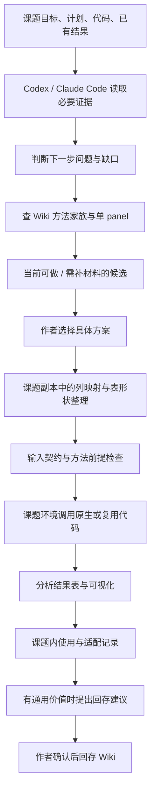

# 方法复用与课题推荐升级 · 设计

> 实施状态（2026-10-21）：用户确认后已实施并部署。以下保留原需求/设计/交接基线；当前结果与限制以 [实施与验收记录](acceptance.md) 为准。

日期：2026-10-21。状态：建议实施方案，尚未修改产品。产品行为依据 [requirements.md](requirements.md)；访谈依据 [session.md](../session.md)。

## 1. 选择与理由

保留本地 Markdown Wiki、薄后端、前端展示和 agent 在课题中工作这一架构。增加三部分：有边界的家族说明、可解释的语义关系、课题侧适配记录。代码浏览复用现有资产，不另建独立代码分类。

| 方案 | 效果与代价 | 结论 |
|---|---|---|
| 继续只按接口完全匹配 | 改动少，仍会漏掉格式不同但有价值的方法 | 不满足 R08 |
| 去掉接口与输入校验，只凭相似描述匹配 | 找到更多候选，但容易混淆行单位、指标定义和科学前提 | 不采用 |
| 发现阶段按语义与前提找候选，执行前适配并检查具体契约 | 保留现有接口与 render，补关系记录和课题适配 | 选定的设计方向；与 Q057、Q059、Q060 一致 |

这里的接口仍有作用：它是说明输入／输出的契约与执行前检查目标，不再是推荐阶段唯一的筛选门槛。

## 2. 职责与主流程



- agent：理解研究目标和数据意义，读页面、核对前提、形成推荐、按授权适配和运行。文件存在只证明材料存在；没有日志或结果不能标为已运行。
- Wiki 后端：提供页面／关系／代码清单和文件读取，校验引用，生成反向关系和图谱。后端不调用模型、不执行分析，也不猜列的科学含义。
- 前端：展示用途、关系与状态，浏览只读代码；不承担训练和统计计算。
- 当前课题：拥有数据、运行环境、适配副本、结果和使用记录。Wiki 仅保存必要引用及经确认回存的通用知识。

## 3. 方法家族的表示

继续使用现有 `method` 页，不新增“家族”节点类型，也不按每个模型复制一套同义方法。

每页补充以下可读内容：

1. 分析目的和不变的核心步骤。
2. 原始具体实现：模型、任务、来源代码及实际验证范围。
3. 可推广的范围：相近方法分支及成立条件。
4. 限制、尚未实现或未验证的分支。
5. 输入输出的语义、可关联图样与可取得的代码版本。

“适用于某分支”“已有该分支代码”“该分支已跑过”分开呈现。例如原代码只有 XGBoost 时，家族标题不能让查看者以为已有所有模型的实现。原生代码可保持原样；复用代码的参数化仍不改变统计含义，必要算法变更先询问。

实施时复核现有 SHAP 页中无条件“任意模型”等表述，用可核实的范围与证据替代；不在方案阶段宣称具体分支已成立。

## 4. 多对多关系：一份记录，两端展示

建议在方法页的 YAML 中新增可选 `figure_relations` 列表，作为人工／agent 语义审查结果的唯一记录。图页的“可用方法”由它反向计算，避免两边分别维护产生冲突。

示意字段，执行者可调整命名而保持语义：

```yaml
figure_relations:
  - figure: templates/example-panel
    compatibility: adaptable  # direct / adaptable / candidate
    reason: 该图表达本方法的逐条结果；需要将宽表整理成长表
    prerequisites:
      - 每行代表同一种验证单位
    adaptation: 列映射和长宽表整理；具体课题映射不回写此处
    evidence:
      - 方法页与图样输入说明的具体来源位置
    verification:
      state: not_run          # not_run / example / project
      scope: 尚未用实际课题调用
      evidence: []
```

关系目标既可为可调用模板，也可为单 panel 来源图样。后者必须明确“图样参考／尚待模板化”，不能标成可立即执行。

三种兼容状态：

- **直接可接**：目标是可调用模板，已核对方法输出和图输入的语义、粒度、单位、前提与所需表，当前契约无需适配。该判断仍不代表真实课题已验证。
- **需要适配**：已存在有依据的对应关系，可说明需修改的列映射或数据形状；具体课题是否可转换仍要检查。不能将缺少样本、模型或统计结果伪装成格式问题。
- **待核实**：信息不足但有具体可检查依据。写明未知项，不当作可直接执行方案。

页面状态、关系兼容状态、代码／调用验证状态是三个维度。`ready` 方法笔记不保证所有模型分支有可用代码；一次示例验证不保证任意数据或模型适用。

### 入库检查

新增方法时查已有单 panel／模板；新增图时反查已有方法。阅读用途、每行单位、输入输出与方法前提，分别写出可接、需适配、待核实关系，或检查后未找到关系的原因。样式相像或共享标签不足以建兼容关系；需核对不同来源的既有知识，而不是只连接同帖页面。

每次检查在条目正文记录检查范围与决定依据。`lint` 校验字段、目标和理由是否齐全；科学含义由 agent 审查，不能用 lint 通过代替。

### 与现有接口图兼容

现有 `feeds` 仍表示已声明的接口结构流向，前端称“接口结构匹配”，不自动扩大成“语义已验证”。新增关系通过独立的关系边或边属性展示，标明兼容状态。普通来源／参考链接继续保留。

方法和图的两端详情、方法配图、反向查询、图谱均读取同一个关系计算结果。来源待模板化或代码未验证时保留可见提示。

对旧库不自动把所有同接口关系填成 direct：现有关系先作为结构候选，经语义检查后补充。有关输入、代码或含义的实质更新应重查受影响关系，不能沿用不再成立的旧结论。

删除／归档继续影响推荐范围。删除时现有清理逻辑需覆盖新关系字段；他页作者备注仍不可自动改。

## 5. 按课题推荐与适配

### 5.1 读取课题

由当前 agent 在作者当前课题目录读取必要资料，不由网页服务器接收任意磁盘路径后扫描。优先已有计划、数据说明、代码入口、结果表头与运行记录，必要时读少量数据核对含义。

在项目约定目录存本次使用记录；没有约定时使用 `<课题>/wiki-use/<本次标识>/`。建议产物：

- `context.json`：研究问题、数据／样本单位、当前阶段、已确认完成的工作、现有材料及证据位置、未知项。
- `recommendations.md`：当前可做项、需补材料项、排序理由、Wiki 引用、候选图样和代码状态。
- 选择后生成的 `mapping.json`／适配脚本：实际输入输出、列映射、形状整理、检查结果与运行记录。

这是课题侧记录，不是新数据库。项目已经有等效计划／日志时链接复用，不要求复制大段原文或敏感原始数据入 Wiki。

### 5.2 候选发现

增加“找方法”入口，使没有现成配图的方法也能被发现；不能继续把方法查询限制在“遍历模板 → 查接口兼容的方法”。可新增 `suggest-methods`，并扩展现有 `suggest`／`suggest-pipeline` 的候选信息。

确定性检索提供已确认方法、图样、输入要求、关系、代码可用性与缺失项；关键词／列覆盖用于排序线索，不把低列覆盖直接当作不适用。agent 阅读候选正文和来源，以研究目的及科学前提完成判断。

为已有结果选图时，从实际结果含义出发，不要求先在 Wiki 中注册一个新的“方法”；也不为了图而把课题结果改造成另一种统计含义。

推荐数量保持简洁，沿用既有少量候选的交互；不做无依据的精确相关度或科学有效性评分。归档条目不作为推荐结果。

### 5.3 语义与格式的分别检查

接口说明保留列契约，必要时增加每行单位、数值含义、量纲、分组／不确定性含义等描述。发现阶段核对这些含义，而不是只比较接口 slug 或列名。

允许自动处理：经确认语义一致的列重命名、列顺序、长宽表整理、文件名整理。采用函数列映射或生成规范表副本均可，但必须满足实际入口的检查；原有 `render` 的严格检查可继续保留，不能通过关闭校验获得“兼容”。

不得静默处理：未知单位、同名指标定义不同、重复样本含义不清、缺关键数据、需要新统计量、自动聚合／删缺失／补点、改变验证设计。说明差异并询问。

适配检查至少核对：源表哈希／关键值未变、映射一一对应、实体和单位未变、顺序符合显式约定。长宽转换行数变化按转换规则核对键与数值可还原，不错误要求总行数完全相同。

候选阶段不训练、不改数据；选定后在课题环境执行。缺包按既有规则处理，不改用 Wiki 环境代跑分析。

### 5.4 回存

本次映射和脚本先留课题，通过使用记录链接到所用知识。可复用价值明确时，提出内容、适用条件、验证范围和拟改文件，作者确认后才回存通用说明或复用版代码。不得自动覆盖原生文件或全局接口定义。

## 6. 原生代码保存与前端查看

### 资产组织

- 方法页继续使用 `methods/<id>/source/` 保存原版，`code/` 保存复用版。
- 图样／模板同样区分原生来源与绘图适配代码。画廊已有 `original_code/`、`code/` 时只读引用或按既有归档规则保存来源副本，不改原始画廊。
- 建议每个条目有可选 `code-manifest.json`，记录文件所属版本、相对路径、原语言、来源、许可证、原始哈希、关联实现／分支、验证状态和证据。它描述现有文件，不生成不存在的“原始代码”。
- 旧条目可先按实际目录列出文件；没有清单的验证状态为未知。空目录不显示成“已有可调用代码”。
- Python、R 和已有文本配置可直接查看。其他原生材料按原文件保留；Notebook 可先以源文件文本查看／下载，不新增输出执行器或将其悄悄转换成脚本。

### 前端行为

方法卡、单 panel 图样卡、模板卡均提供独立“查看代码”按钮，不与打开详情、翻面和删除动作嵌套冲突。点击打开当前 Wiki 内的只读面板或页面：

1. 选择原始版／复用版；显示是否只有片段或重建代码。
2. 按文件列表切换；显示文件名、语言、来源与验证范围。
3. 查看带行号的纯文本代码，复制当前文件，下载当前原始文件。
4. 无代码或无法解码时清楚提示，必要时仅下载原件；不伪造空代码模板。

不在查看时执行、导入或安装代码。原始代码中的 HTML／Markdown／Notebook 输出按数据处理，不作为前端可执行内容。

### 后端能力建议

可采用以下端点或等效实现：

- `GET /api/{kind}/{id}/code-files`：实际文件清单、版本、语言、来源、验证状态。
- `GET /api/{kind}/{id}/code?...`：当前条目、指定版本下的文件文本。
- `GET /api/{kind}/{id}/code-download?...`：原字节文件下载。
- 页面／关系 API 返回正向与反向兼容关系，agent CLI 使用同一关系模型。

只接受已枚举的条目资产文件；拒绝绝对路径、目录穿越、越界重定向及读取无关磁盘。前端安全渲染文本，文件下载保持原字节。无需新增网页执行接口。

## 7. 迁移与兼容

1. 盘点真实状态和代码，保存页面、接口、资产及作者区哈希。已有方法确认和模板状态以正式库当前状态为准，不照搬旧文档的待确认描述。
2. 通过支持的 API 归档 `paired-reference-visual-comparison`、`repeated-benchmark-distribution`。保留历史，有依据内容并入 `regression-resampling-evaluation` 的范围、输入或绘图说明；不复制不成立的分析推广。
3. 清理研究 Wiki 及 sci-figure-replica 中“广泛联想其他分析类型”的旧指引，改成有边界的方法家族推广。保留单 panel、任意 n、来源与用户备注保护。
4. 复核 SHAP 方法家族及原实现的对应关系。以核实证据记录支持情况，未验证部分明确保留。
5. 给当前真实方法／图样补关系与代码清单；不自动恢复归档整图，不自动完成暂停模板。
6. 源码、前端构建、规则和两技能的三处安装保持一致。配置仍指向 `E:\research-wiki\知识库` 与 `画廊`。

## 8. 故障与边界场景

- 课题目的不明：问目的，不凭库存决定课题方向。
- 数据只有预测、没有模型等材料：能做的可视化独立推荐；依赖缺失材料的方法只列补材料候选。
- 同名不同义：保留未知，不显示 direct，不改接口凑一致。
- 代码无法验证：原生版本仍可保存和查看，明确未验证，不因此丢弃知识或承诺可运行。
- 中途暂停：保存项目上下文、候选与映射状态；恢复时核对文件变化，再从已确认步骤继续。
- 结果异常或需要统计逻辑变化：保存现场，按既有规则询问。
- 删除与归档后：不推荐旧节点，关系与代码清单不能出现悬空的“可直接接”承诺。
