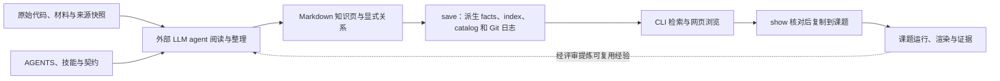
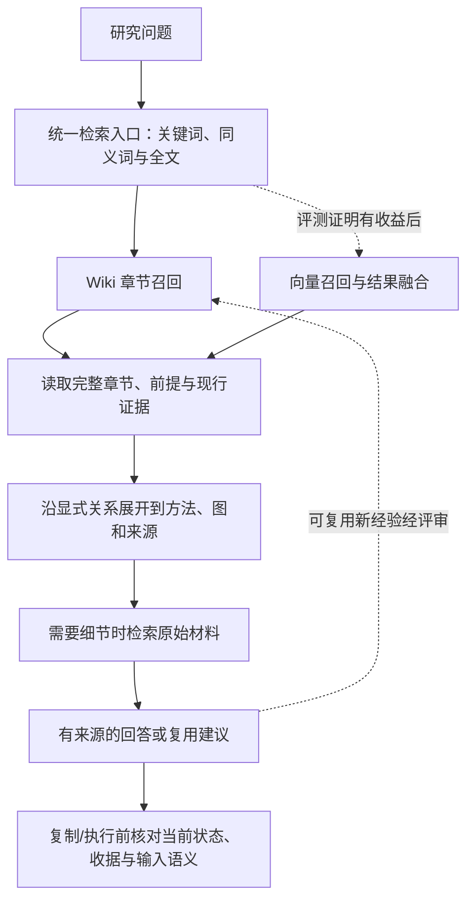

# research-wiki 架构检查与选型建议

检查日期：2026-11-13（Asia/Shanghai）。对象：`E:\research-wiki` 正式知识库与嵌套开发仓库。检查时提交为 vault `3360f0e4`、dev `76d4bd7`。

## 结论

**项目符合 LLM Wiki 模式，而且已经扩展为带运行证据的科研方法与代码资产库。建议保留 Wiki 作为知识主干，优先改善现有检索，再根据实测收益增加 RAG 能力。没有依据认为应把它整体替换成“原始文件切块 + 向量检索 + 聊天”。**

这是一项基于当前代码、知识页和查询探针的架构判断。没有实现新的 RAG 系统做对照，因此不能宣称某方案已经在准确率、成本或延迟上胜出。

需要区分两个问题：LLM Wiki 侧重知识如何被持续整理、复用和维护；RAG 侧重回答问题时如何取回外部证据。两者可以组合。本文把“纯 RAG”限定为主要对原始材料建索引、没有持续维护的领域知识页的方案，避免把所有 RAG 都等同于简单向量搜索。

## 1. 实际架构与 LLM Wiki 的对应关系

Karpathy 原文把 LLM Wiki 描述为一种个人知识库模式：保留原始来源，由 agent 持续编译互链 Markdown，按规则执行 ingest、query、lint；原文也允许为 Wiki 增加搜索。因此“使用检索”与“属于 LLM Wiki”并不冲突。[原始说明](https://gist.github.com/karpathy/442a6bf555914893e9891c11519de94f)

| 架构特征 | 本项目当前落点 | 判断 |
|---|---|---|
| 原始来源与整理结果分开 | 上游快照、画廊、配方/方法 `source/`；来源 commit、许可证与哈希 | 符合 |
| 持久化、可读的知识本体 | 方法、接口、图型、场景、配方、模板等 Markdown 页面 | 符合 |
| agent 维护知识与关系 | 方法语义去重、适用/不适用、输入输出、方法—图关系与来源对照 | 有规则，也有实际内容 |
| 统一维护规则 | `知识库/AGENTS.md`、技能、references、类型与收据契约 | 符合 |
| 索引、日志与版本管理 | `save()` 重建 facts/index/catalog、追加日志并提交 Wiki 子树 | 已实现 |
| 查询与实际使用 | `find → show → use → run/render` | 已实现 |
| 质量维护 | lint、验收快照、代码/输入/输出指纹、逐实现验证状态 | 已实现，但有明确能力边界 |

这里的 LLM 是使用技能的外部 Codex/Claude Code 等 agent。核心 Python/React 实现主要提供确定性的解析、检索、保存、复制、执行和展示；没有在检查的核心模块中发现内置模型推理、embedding 或向量库查询链。**这不妨碍它成为 LLM Wiki，但意味着它不是一个脱离 agent 就能自主理解和编写知识的聊天系统。**

当前路径可以概括为：

关键实现：[`store.py:71`](../../开发/staged/research-wiki/rwiki/store.py)、[`finder.py:115`](../../开发/staged/research-wiki/rwiki/finder.py)、[`acceptance.py:119`](../../开发/staged/research-wiki/rwiki/acceptance.py)、[`method_implementations.py:87`](../../开发/staged/research-wiki/rwiki/method_implementations.py)。链接标签中的行号用于定位，链接本身指向文件。

## 2. 本次实际核查了什么

读取了当前规则、README、LLM Wiki 模式说明，以及 catalog/finder/store、页面关系、推荐、验收、实现收据、lint、项目证据状态和前后端查询实现；抽查了差异表达、细胞注释等知识页的正文和声明。

| 只读统计 | 当前结果 | 解释 |
|---|---:|---|
| 正式页面 | 334 | 按正式页面目录顶层 Markdown 统计，不含代码目录 README |
| 方法页 | 43 | 15 分析家族、22 技术资料、6 组合流程 |
| 配方 / 模板 | 146 / 30 | 包含正式存储的页面；存储数不等于默认可检索数 |
| 场景 / 来源 | 7 / 2 | 场景页显式组织首选组合 |
| 接口 / 图型 / 版式 | 26 / 53 / 27 | 其中版式含 3 个 archived |
| 默认 catalog 条目 | 244 | 7 场景、30 模板、131 配方、43 方法、33 L0 项 |
| 正文页面双链 | 999 条无向边 | 305 个页面有连接；不含元数据关系与资产链接，未应用筛选隐藏 |
| 正文无页面双链 | 29 个页面 | 本次均为图型概念页；不代表无元数据引用，也不直接等于知识缺陷 |
| 当前 catalog 的 usable | 30 模板、14 配方、14 方法 | usable 与 run=pass、ready、科学有效性不同；不能混为“验证完成” |
| 当前 lint | 0 ERROR、99 WARN | 63 条方法诊断、36 条配方诊断；不是 99 个独立问题或条目 |

当前索引不存在 lint 报告的过期警告。99 条 WARN 主要记录未运行实现、独立性证据缺口和配方当前失败；应保留其证据边界，不能为了得到全绿而改状态。

用现有 `test_v2_sources_recipes.py` 定向执行了 L0 catalog 与 find/show 两项测试：**2 passed，16 deselected，4.01 秒**。这两项测试验证基本功能，没有覆盖下面发现的语义召回与别名冲突。

证据文件：[`evidence.json`](evidence.json)、[`retrieval-probe.json`](retrieval-probe.json)、[`lint.txt`](lint.txt)、[`validation.txt`](validation.txt)。复核脚本：[`audit.py`](audit.py)、[`retrieval_probe.py`](retrieval_probe.py)。审查用临时测试仓库位于 `pytest-tmp/`。

## 3. 当前架构的强项

### 3.1 已经形成可影响研究动作的知识

抽查的差异表达页不只是保存源代码：它区分细胞级检验与患者/样本级推断，说明何时需要按样本处理；方法到气泡图的关系还明确写明 `avg_expression` 不能用 `avg_log2FC` 代替。细胞类型注释页区分参考注释与 marker 路线，记录输入、限制和分支验证范围。

这些是当前页面中保存的领域判断，并非本次重新做过的科学验证。它们说明 Wiki 的价值在于沉淀“怎么选、如何适配、何时不能用”，而不只是让模型找到一段代码。对应页面：[`differential-expression.md`](../../知识库/methods/differential-expression.md)、[`cell-type-annotation.md`](../../知识库/methods/cell-type-annotation.md)。

### 3.2 知识确认与运行证据分开

`ready_for_use()` 会检查状态、内容门槛和验收是否过期；方法执行推荐还需要当前可核对的实现。实现验证与独立迁移验证分别管理。原字节、复用代码、示例和收据不必压缩成聊天片段，来源也可以追踪。

若整体替换为原始代码切块问答，这些能力不会自然继承；成熟 RAG 当然也能增加这些治理措施，但那是额外设计，不是建立向量索引后自动获得。

### 3.3 图谱有真实结构，但不是现成的 GraphRAG

`GET /api/graph` 组合正文双链、接口流向和显式方法—图关系，能够展示知识网络。当前 `find()` 没有利用这些边做查询展开，也没有社区聚类、社区摘要或基于它们的回答链。

Microsoft GraphRAG 的官方流程包含文本单元、实体/关系抽取、社区层次、摘要及局部/全局查询；所以不能据已有 3D 图谱就认定项目已采用 GraphRAG。[官方文档](https://microsoft.github.io/graphrag/)

## 4. 当前的具体短板

### 4.1 检索是规则匹配，遇到自然语言问法会明显退化

`finder.py:210–285` 的主要机制是标题/摘要/关键词子串匹配、中文二字片段、图型/领域扩展、场景首选加权和可用性加分。它不是 BM25，也没有 embedding 或重排器。

本次共运行 19 个查询探针，再对两个已知目标页检查全结果排名：

| 查询 | 已知相关方法页 | 排名 |
|---|---|---:|
| `differential expression` | 差异表达分析 | 1 |
| 比较两组细胞哪些基因表达不同 | 差异表达分析 | 6 |
| `cell annotation` | 细胞类型注释 | 1 |
| 判断每个细胞属于什么类型 | 细胞类型注释 | 20 |

这能证明当前检索对问法敏感，不能据此计算总体准确率；没有随机抽样、独立标注或 RAG 对照。

### 4.2 确认存在英文短别名误扩展

查询 `coexpression` 会被 `_expansions()` 扩展到 `diagnostic-roc`。原因是词表别名 `PR` 被小写后，以无词边界的子串规则命中了 `coexpression` 中的 `pr`。随后的领域加分与场景首选加分，使校准、列线图和决策曲线排在前面。

这不是“知识库没有共表达材料”，也不是需要向量库才能修的问题，而是当前别名匹配规则的具体缺陷。应优先修复英文缩写的词边界与匹配条件，再测替代检索方案。

### 4.3 默认检索覆盖小于实际知识本体

`catalog_records()` 只为 scenario/template/recipe/method/item 生成可检索记录。接口页、图型概念页、课题页、历史版式页没有作为独立结果进入该 `find` 目录；正文、详细理论、来源代码和验证材料也不是完整的检索语料。

`_method_record()` 会把用途压成短摘要，较长的限制与输入语义留在页面里。好处是目录轻；代价是研究问题可能命中不了只在正文出现的关键条件。答案层应能按需读取完整章节及来源，不能仅把 catalog 摘要当完整知识。

### 4.4 CLI、主网页与独立静态搜索有不同匹配规则

CLI 使用加权与扩展；主前端 `filterAnalysisMethods()` 对元数据组合后的字符串作完整 query 子串匹配，其他浏览入口又有自己的分词逻辑；独立静态搜索另外按分面与关键词工作。因此同一句话在不同入口中可能得到不同结果。

建议维护统一的检索与排序契约。网页可以保留轻量过滤，但应明确与研究问题检索的差别，并共享同义词、类型、来源和状态解释。

### 4.5 结构治理不能代替知识治理

`save()` 自动更新派生事实和索引，不会自动重新理解原始材料、改写所有理论段落。lint 对分析家族重复的自动检查主要是规范化标题；语义同义、科学矛盾和统计前提仍依赖 agent 审查。

代码与验收收据已经有失效检查；项目状态层还对声明过的 observation 正负证据处理冲突。这里的缺口更准确地说是：**未看到把全库任意自然语言论断绑定到精确来源片段、并在来源变化时自动传播复核任务的通用机制。**不能笼统说“项目没有冲突或过期管理”。

另外，`find()` 从保存的 catalog 读取 usable/run 字段；外部编辑发生后到下一次 save 之前，目录可能滞后。因此未来回答/执行层应按当前原文件重新核对证据门槛。当前本次 lint 未发现目录过期，这一条是由代码得出的风险窗口，不是已观测到的当前错误。

## 5. 与 RAG 的针对性比较

原始 RAG 论文把参数化模型与外部可检索记忆结合，使用检索到的内容支持生成；该论文的实现采用密集向量索引。但架构选择时，不应把所有检索增强系统限定为这种索引实现。[Lewis 等，2020](https://arxiv.org/abs/2005.11401)

以下是针对本项目任务的工程判断，不是已经测出的性能排名：

| 任务/代价 | 现有 LLM Wiki | 主要检索原始材料的 RAG | Wiki + 检索增强 |
|---|---|---|---|
| 找现成图模板、复制代码到课题 | 已有成熟业务契约 | 需额外建设资产与执行契约 | 继承现有能力，改善发现 |
| 记住方法边界与历史适配决策 | 可维护为稳定领域知识 | 需每次检索相关材料并综合，或另建记忆 | 先用整理知识，再按需回源 |
| 查询大量文献或长材料的细节 | 手工/agent 编译成本较高，目录覆盖有限 | 适合按需检索；仍依赖解析、切分与召回质量 | Wiki 导航，原文补细节与证据 |
| 日常中文问法、跨中英文别名 | 当前较弱 | 语义召回有潜力，但需实测 | 同时利用结构化线索和语义线索 |
| 来源持续变化 | 当前有代码/收据失效管理，理论更新依赖审查 | 可以增量索引，但也会遇到索引过期 | 两层都需要版本与失效契约 |
| 维护成本 | 整理、去重、复核负担 | 索引、模型、切分、检索评测负担 | 能力更完整，也需控制复杂度 |

LLM Wiki 也会把错误长期保存，RAG 也可能检索错、漏掉限定条件；任何一方都不自动保证科学正确。真正需要比较的是相同任务下的证据完整性、可用性判断和实际成本。

## 6. 推荐方向与实施优先级

**保留原始来源 + Markdown Wiki + 规则/验证体系，让新增检索索引成为可删除、可重建的派生物。**

1. **先修现有检索质量。** 修英文短别名误匹配；补同义词与中英术语；处理方法、绘图、概念等问题类型；统一 CLI/前端语义。对于“找方法”的问题，可提升分析家族的权重，保留显示技术资料和绘图的能力。不要仅靠可用性加分把不相关但能运行的条目顶上去。
2. **补全文检索，再决定是否上向量。** 按用途、原理、适用/不适用、输入、输出等章节建索引；保留页面 ID、章节、来源、版本和父页面。先与 BM25 等关键词方案比较，处理中文分词或字符粒度，不把通用英文默认配置直接当作中文方案。
3. **需要语义召回时做混合检索。** 在现有结构化和全文检索之外增加向量召回，融合/重排后读取完整父章节；数值、字段名、函数名、包名等精确信息继续保留词法通道。当前规模不足以单凭页数证明需要独立向量数据库。
4. **利用现有关系，回源补证据。** 方法→接口/图→来源的受控关系可以先做有限跳数展开，避免把相关性图谱当科学适用证明。暂不优先引入 GraphRAG 的全量实体抽取和社区摘要流程。
5. **设计跨层证据契约。** 问答返回页面/章节与来源定位，标明哪些是已整理知识、哪些来自原材料；执行建议实时调用已有门槛。知识问答允许引用 draft/not_run 来解释缺口，但它们不能因此取得执行资格。研究目的、单位、分组与估计目标仍需核对，不能由向量相似度决定。

新增向量能力与项目现有 `references/llm-wiki-mode.md` 中“不引入数据库、向量库”的约束不同；若进入实施，需要明确修订该规则及索引边界。本次只给出评估，没有安装依赖或修改该约束。

## 7. 如何决定升级是否值得

建议建立 30–50 个由实际使用问题组成的评测集。标注相关页面/章节、必要原始证据、应排除的误用，以及该问题是否允许给出可执行建议。

对照至少包括：当前检索、修复规则并补全文的方案、混合检索方案。使用同一模型、相同上下文预算与同一版本语料，分别记录：

- 召回：Recall@5/10、MRR；方法/模板/概念分别看，不能只统计总命中。
- 回答：必要限定条件是否保留，来源能否定位，是否存在无依据的合并推断。
- 使用：是否错把未运行/过期实现推荐为可执行，能否选到正确资产与分支。
- 更新：删页、改代码、更新来源后，索引与执行门槛能否及时失效。
- 成本：索引构建/更新、查询延迟、模型 token、人工维护时间。

只有新增方案在这些真实任务上表现出稳定收益，才值得承担模型、索引和维护成本。若规则修复与全文检索已解决主要问题，可以继续使用轻量实现。

## 检查边界

本次运行的是架构审查、当前知识库只读 lint 和两个既有定向测试；未运行科研分析、R/绘图回放、完整测试套件、实时前端验收或模型问答对照。Anaconda 解释器未装 FastAPI，因此 API/前端链路只检查了源码。没有修改正式知识页、业务代码、统计逻辑或 Git 提交。

本报告与探针是新建的本地审查产物；所有结论均区分了实际观测、代码推断与待评测建议。
